# Manual do Usuário

**Oráculo dos Direitos Trabalhistas** · versão 1.0.0 (Release Candidate) · https://oraculo-direitos-trabalhistas-8na.vercel.app

## 1. Apresentação

O Oráculo responde dúvidas sobre direitos e obrigações no trabalho em linguagem simples. Você escreve a pergunta do seu jeito, e o sistema procura a resposta na **Cartilha de Direitos e Obrigações no Trabalho do Tribunal Regional do Trabalho da 4ª Região (TRT4)**. A resposta sempre mostra de qual parte da cartilha ela veio, com o link para conferir.

O Oráculo **não inventa respostas**: se a cartilha não trata do assunto, ele avisa. As respostas são informativas e não substituem a orientação de um advogado, do sindicato ou da Justiça do Trabalho.

## 2. Para quem é

- **Qualquer pessoa** que tenha dúvidas sobre o trabalho, em especial trabalhadores informais e de aplicativos, trabalhadores domésticos, jovens no primeiro emprego, estudantes e estagiários. Não é preciso criar conta para perguntar.
- **Quem quer acompanhar temas** (por exemplo, Férias ou Rescisão) e receber as novidades por e-mail: precisa de uma conta de **usuário**.
- **A equipe do Oráculo**, que mantém o conteúdo: **curadores** (cuidam da base de conhecimento) e **administradores** (também gerenciam as contas e veem o histórico).

## 3. Acesso e autenticação

| Quem | Como entra | O que pode fazer |
| --- | --- | --- |
| Visitante | Abre o endereço do sistema; não precisa de login | Perguntar e pedir mais conteúdo por e-mail |
| Usuário | Cria a conta em **Crie sua conta** e entra em `/entrar` com e-mail e senha | Também acompanhar temas e ver as novidades |
| Curador | Conta criada por um administrador; entra em `/entrar` | Painel: base de conhecimento, sinônimos, sites e vídeos, atualizações, dashboard e relatório de perguntas |
| Administrador | Conta criada por um administrador; entra em `/entrar` | Tudo do curador, mais usuários e histórico de operações |

- O botão **Entrar** não aparece na tela de perguntas, porque quem só quer perguntar não precisa dele. Para entrar, acesse o endereço do sistema seguido de `/entrar` (por exemplo, `oraculo-direitos-trabalhistas-8na.vercel.app/entrar`).
- A senha tem no mínimo 8 caracteres. A sessão dura **8 horas**; depois disso, o sistema pede para entrar de novo.
- O botão **Sair** fica no canto superior direito do painel.

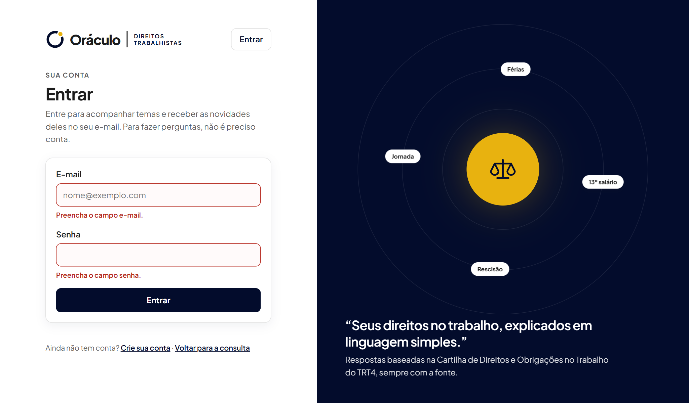

## 4. Fazer uma pergunta

1. Abra o sistema. À esquerda fica o campo **"O que você quer saber sobre o seu trabalho?"**, e logo abaixo, os **temas mais procurados** com perguntas prontas.
2. Escreva a sua dúvida (até 500 caracteres) ou clique em uma pergunta sugerida.
3. Clique em **Perguntar** e aguarde alguns segundos.
4. A resposta aparece no **painel azul**, à direita (no celular, logo abaixo do campo). Embaixo dela, em **Fonte**, aparece a parte da cartilha usada; clique em **Ver na cartilha** para abrir a página original do TRT4.

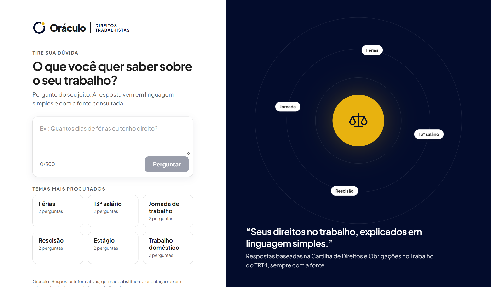

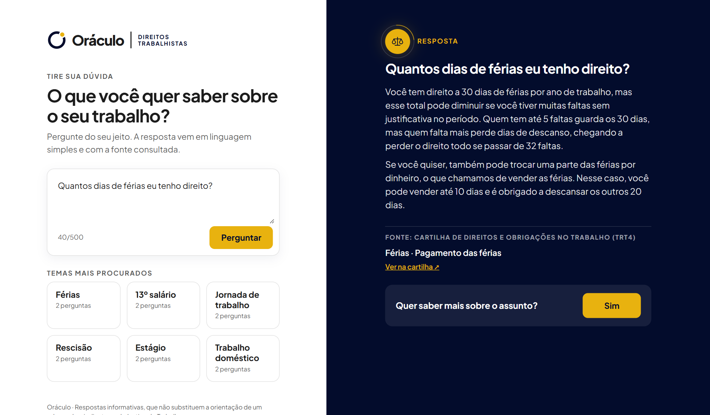

**Dicas:** pergunte uma coisa por vez e use as palavras do dia a dia ("fui demitido", "meu patrão"); o sistema entende sinônimos. Se a cartilha não tratar do assunto, aparece um aviso em vez de uma resposta inventada.

## 5. Receber mais conteúdo por e-mail ("Saber mais")

1. Abaixo da resposta, em **"Quer saber mais sobre o assunto?"**, clique em **Sim**.
2. Na janela **Saber mais**, preencha o **nome** e o **e-mail** e marque a **autorização** (LGPD). O botão **Receber por e-mail** só fica disponível com os três preenchidos.
3. Clique em **Receber por e-mail**. Em alguns segundos aparece **"Pronto! Confira seu e-mail"**.
4. Você recebe a resposta, **sites** e **vídeos** sobre o assunto. Na primeira vez, confira também a pasta de **spam**.

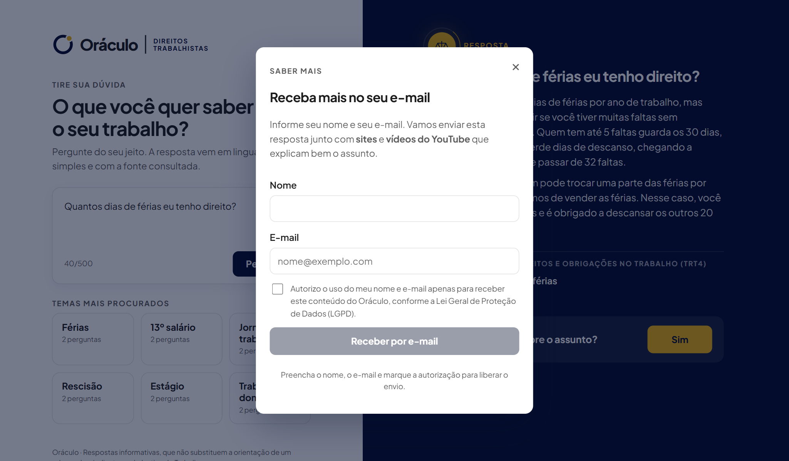

Seu nome e e-mail são usados **somente** para enviar esse conteúdo. Cada e-mail pode fazer até 5 pedidos por hora.

## 6. Criar conta e acompanhar temas (usuário)

1. Em `/entrar`, clique em **Crie sua conta**. Preencha nome, e-mail, senha (duas vezes) e marque a autorização para receber e-mails.
2. Depois de criar a conta, você vai para **Meus temas**.
3. Escolha um tema na lista e clique em **Acompanhar tema**. Sempre que a equipe publicar uma novidade sobre ele, você recebe um e-mail.
4. As novidades também aparecem em **Meus temas**. Para parar de receber, clique em **Deixar de acompanhar**.

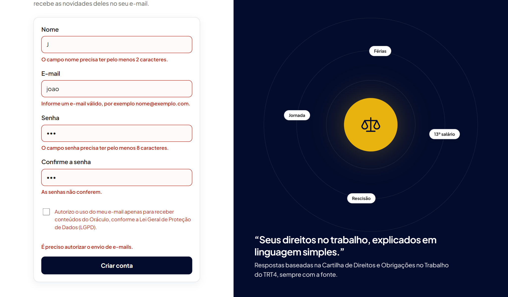

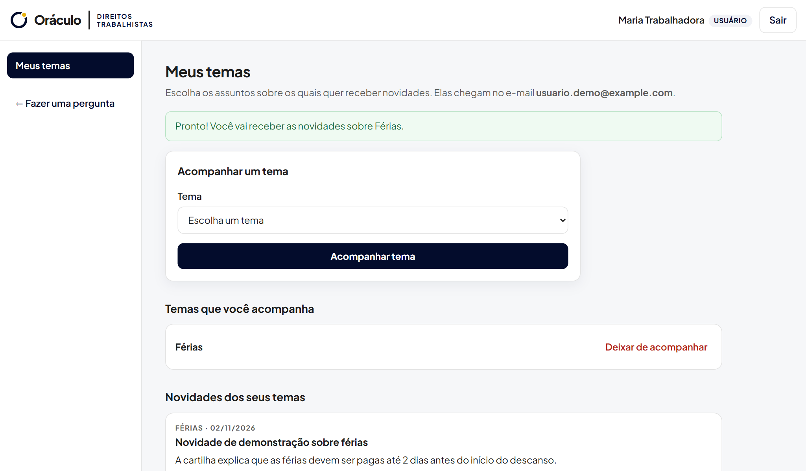

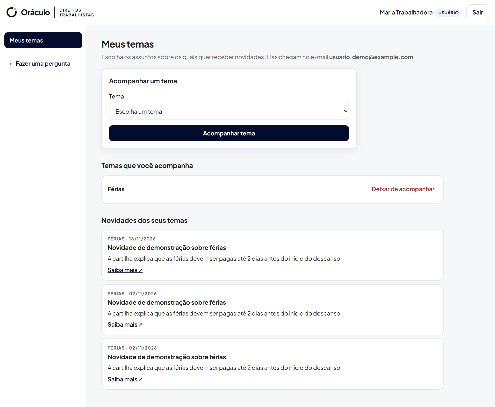

## 7. Painel da equipe (curador e administrador)

Depois de entrar, o menu da esquerda mostra só as áreas do seu perfil.

### 7.1. Dashboard

Mostra, para o período escolhido (7, 30, 90 dias ou 12 meses): quantas perguntas foram feitas, a taxa de resposta, os pedidos de "Saber mais", as pessoas acompanhando temas, um gráfico de perguntas por data, os temas mais consultados e as perguntas que ficaram sem resposta. Nessas, o botão **Incluir na base** leva direto ao cadastro de um trecho novo.

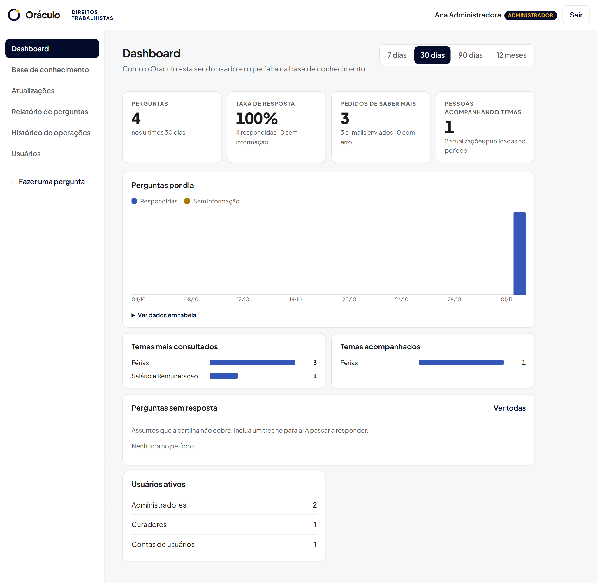

### 7.2. Base de conhecimento

É o conteúdo da cartilha que a IA usa para responder (25 temas e 217 trechos).

1. **Consultar:** filtre por tema e procure por uma palavra do texto.
2. **Incluir:** clique em **+ Novo trecho**, escolha o tema, escreva o subtítulo e o texto e clique em **Salvar**. O trecho já passa a ser usado nas respostas.
3. **Alterar:** clique em **Editar** no trecho, mude o que precisar e salve.
4. **Excluir:** clique em **Excluir** e confirme. A exclusão não pode ser desfeita.

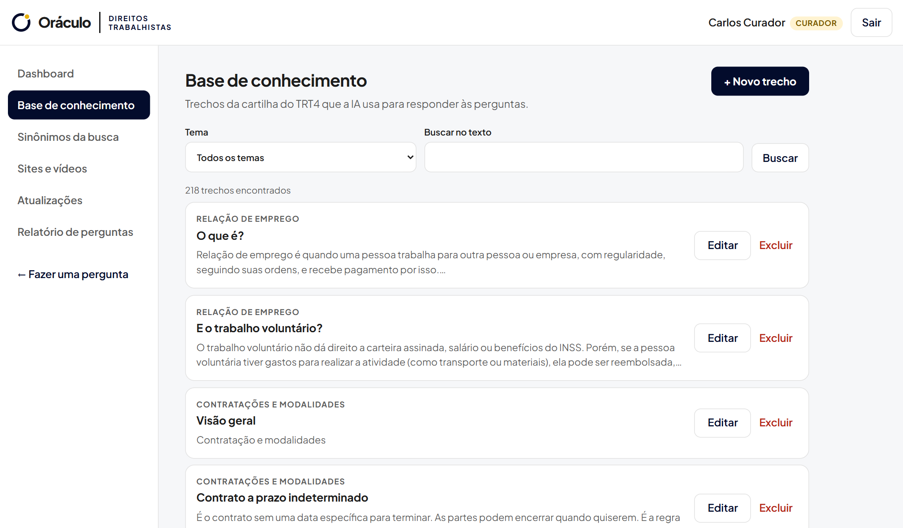

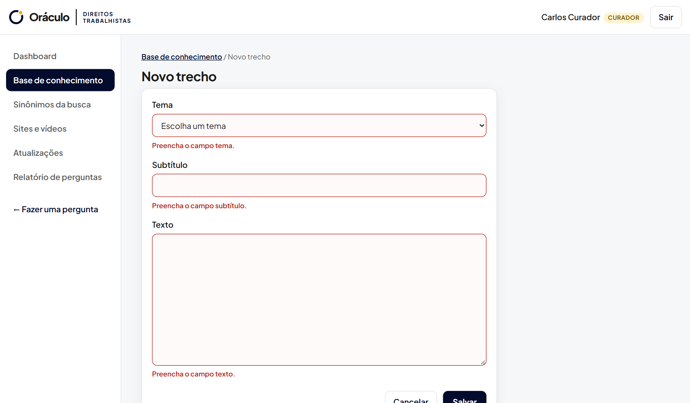

### 7.3. Sinônimos da busca

Palavras do dia a dia que a busca traduz para os termos da cartilha (por exemplo, "patrão" → "empregador"). Use **Procurar**, **+ Novo sinônimo**, **Editar** e **Excluir**. Acentos e maiúsculas são ignorados.

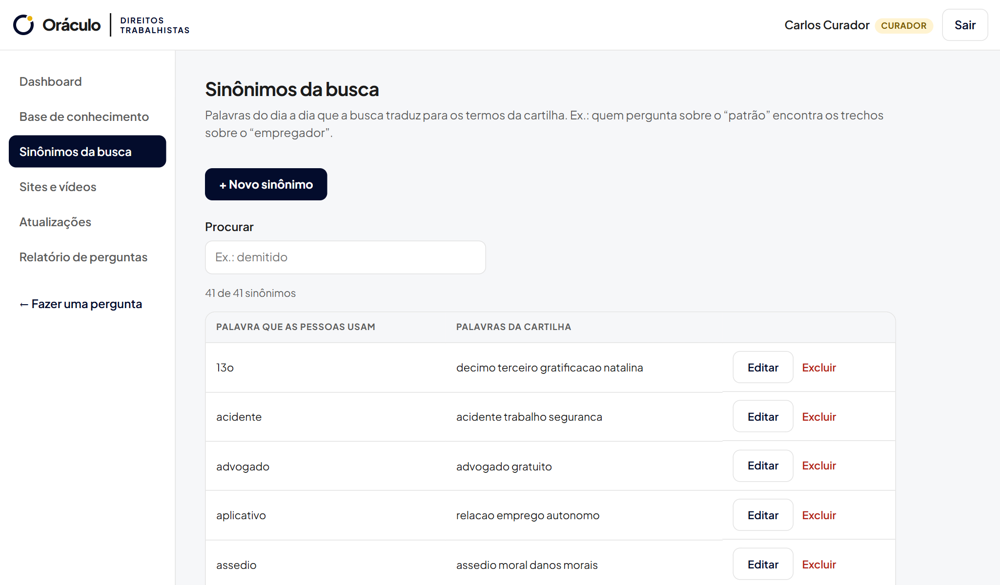

### 7.4. Sites e vídeos do "Saber mais"

Os links enviados por e-mail, agrupados por assunto. Em **+ Novo link**, escolha o tema, o assunto, as **palavras-chave** (separadas por vírgula; se uma delas aparecer na pergunta, a pessoa recebe os links do assunto), o tipo (site ou vídeo do YouTube), o título, o link e a ordem no e-mail. Assuntos sem links cadastrados recebem a página da cartilha, o texto da lei e vídeos do YouTube sobre a pergunta.

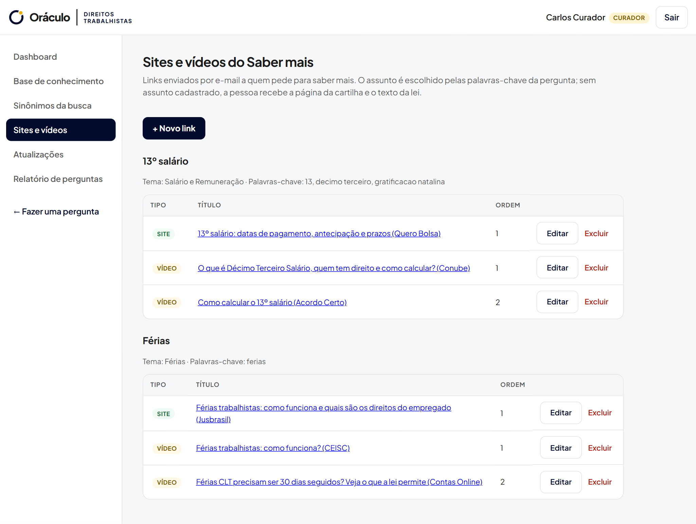

### 7.5. Atualizações (novidades dos temas)

1. Escolha o tema, escreva o título, o conteúdo e, se quiser, um link.
2. Clique em **Publicar e enviar**: todos que acompanham o tema recebem o e-mail.
3. A lista mostra quantos e-mails foram enviados e quantos deram erro. Se houver erro, clique em **Reenviar** para tentar de novo só esses.
4. O curador só exclui as próprias publicações; o administrador exclui qualquer uma.

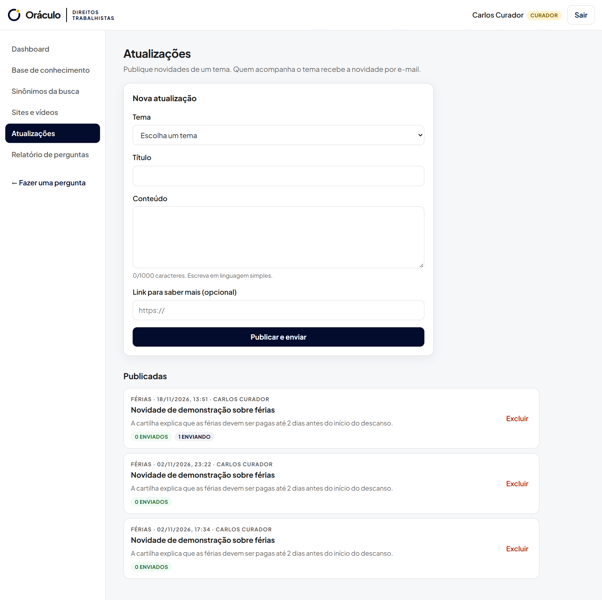

### 7.6. Relatório de perguntas

Lista as perguntas feitas, com filtros por período, tema, resultado (respondida ou sem resposta) e texto. O botão **Exportar CSV** baixa a lista para abrir no Excel. Não há dados pessoais nesse relatório.

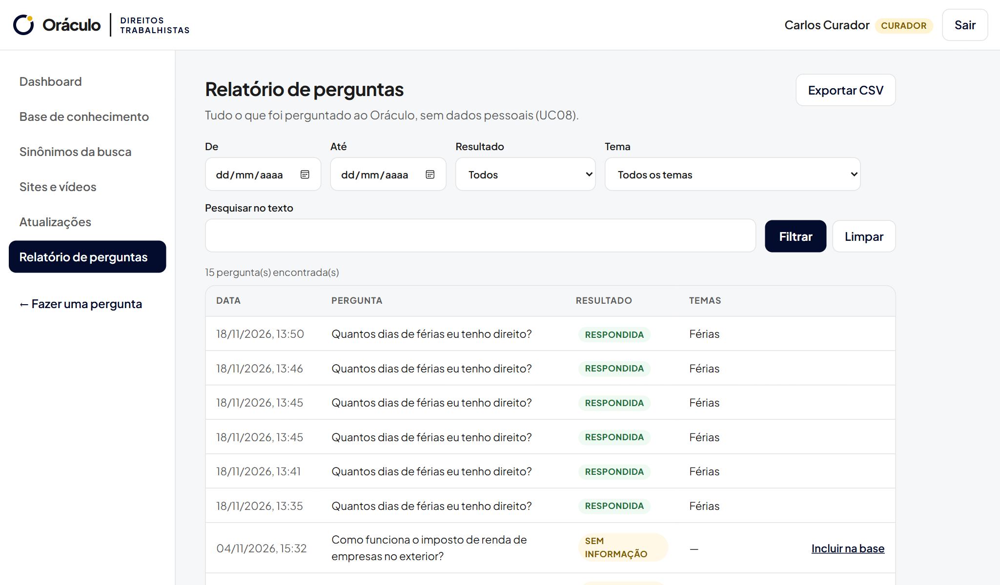

### 7.7. Usuários (somente administrador)

Lista as contas com perfil e situação. Em **+ Novo usuário**, informe nome, e-mail, perfil e senha. Em **Editar**, é possível mudar o perfil, bloquear o acesso (desmarcando **Acesso ativo**) ou definir uma nova senha. O sistema não permite ficar sem nenhum administrador ativo, nem que o administrador exclua a própria conta.

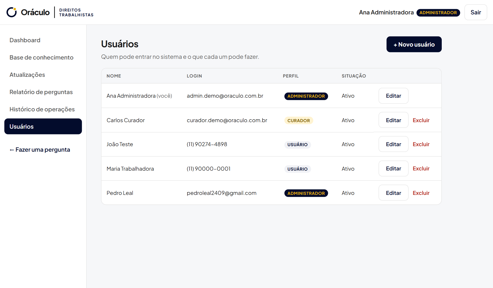

### 7.8. Histórico de operações (somente administrador)

Mostra quem fez o quê e quando: logins, cadastros, inclusões, alterações, exclusões, publicações e pedidos de conteúdo. Há filtros por período, ação, área e texto, e o botão **Exportar CSV**.

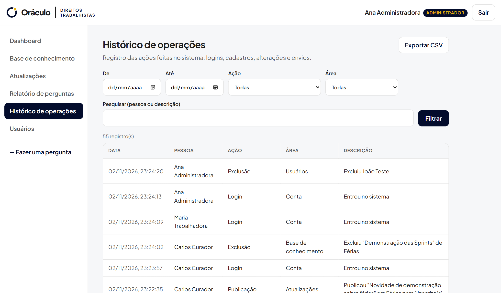

## 8. No celular

As telas se adaptam ao celular: o campo de pergunta vem primeiro e a resposta aparece logo abaixo; no painel, o menu fica no topo e pode ser rolado para o lado.

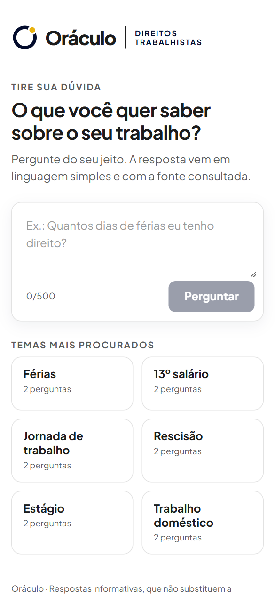

## 9. Mensagens e situações comuns

| Mensagem ou situação | O que significa | O que fazer |
| --- | --- | --- |
| "A inteligência artificial está muito ocupada agora. Tente de novo em alguns segundos." | A IA gratuita do Google está sobrecarregada no momento | Clique em **Perguntar** de novo depois de alguns segundos |
| Aviso de que a cartilha não trata do assunto | A cartilha não tem essa informação | Pergunte de outro jeito ou escolha um tema sugerido |
| "Preencha o campo …" ou "O campo … precisa ter pelo menos … caracteres" | Algum campo está vazio ou curto | Corrija o campo indicado em vermelho |
| "Informe um e-mail válido, por exemplo nome@exemplo.com." | O e-mail está incompleto | Confira o endereço digitado |
| "E-mail ou senha incorretos." | Os dados de acesso não conferem | Confira o e-mail e a senha; a mensagem é a mesma nos dois casos, por segurança |
| "Já existe um usuário com este e-mail." | O e-mail já tem conta | Use **Entrar** |
| "Você fez muitos pedidos na última hora." | Limite de 5 pedidos de "Saber mais" por e-mail | Espere uma hora |
| "Sua sessão expirou. Faça login novamente." | Passaram 8 horas desde o login | Entre de novo |
| "Acesso não permitido" | O seu perfil não tem acesso àquela área | Use o menu da esquerda ou peça acesso a um administrador |
| O e-mail não chegou | Pode ter ido para o spam | Confira a pasta de spam e marque como "Não é spam" |
| "Sem conexão com o servidor" | Falha de internet | Confira a conexão e tente de novo |
