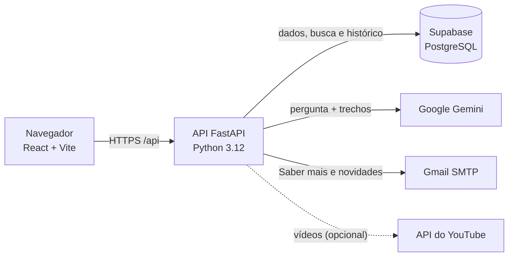

# Manual Técnico

**Oráculo dos Direitos Trabalhistas** · versão 1.0.0 (Release Candidate) · repositório https://github.com/PedroHTLeal/oraculo_direitos_trabalhistas_8na

Este manual reúne o necessário para entender, instalar, executar e manter o sistema. Os documentos de apoio estão em [`docs/`](README.md): [API](api.md), [banco de dados](banco-de-dados.md), [diagramas](sprints/sprint-02/diagramas.md), [configuração](configuracao.md), [publicação](publicacao.md) e [decisões](decisoes.md).

## 1. Visão geral da arquitetura

Arquitetura em camadas. A interface (React) conversa só com a API (FastAPI), que concentra as regras de negócio e é a única parte com acesso ao banco, à IA e ao e-mail. Todas as chaves ficam no backend.

- **Publicação:** Vercel. O site (arquivos estáticos) e a API (função Python, região São Paulo) saem do mesmo repositório, a cada envio ao `main`.
- **Execução local:** `iniciar.bat` compila o frontend e o próprio backend serve o site em http://localhost:8000.
- Diagramas de arquitetura, classes, MER e modelo relacional: [Sprint 02](sprints/sprint-02/diagramas.md).

## 2. Tecnologias e bibliotecas

| Camada | Tecnologia | Versão | Para que serve |
| --- | --- | --- | --- |
| Backend | Python | 3.12 | Linguagem do servidor |
| | FastAPI | 0.115.6 | API, validação (Pydantic) e documentação OpenAPI |
| | Uvicorn | 0.34.0 | Servidor da API em execução local |
| | supabase-py | 2.33.0 | Acesso ao banco |
| | google-genai | 2.34.0 | IA (Gemini) |
| | httpx | 0.28.1 | Chamadas HTTP (API do YouTube, testes) |
| | python-dotenv, email-validator | 1.2.4, 2.3.0 | Variáveis de ambiente e validação de e-mail |
| Frontend | React, React DOM | 18.3 | Interface |
| | React Router | 6.30 | Navegação entre telas |
| | Vite | 6 | Compilação e servidor de desenvolvimento |
| Banco | Supabase (PostgreSQL) | — | Dados, busca textual em português (`unaccent`, `tsvector`) |
| Testes e qualidade | pytest, ruff, ESLint, Playwright | 8.3, 0.8, 9, 1.64 | Testes, verificação do código e roteiro de testes no navegador |
| Integração e entrega | GitHub Actions, Vercel | — | Testes a cada envio, rotina que mantém o banco ativo e publicação |

As versões do backend estão em [`requirements.txt`](../requirements.txt) (produção) e [`backend/requirements-dev.txt`](../backend/requirements-dev.txt) (desenvolvimento); as do frontend, em [`frontend/package.json`](../frontend/package.json).

## 3. Organização do código

### Backend (`backend/app/`)

| Arquivo | Responsabilidade |
| --- | --- |
| `main.py` | Cria a API, registra as rotas, trata erros (mensagens em português) e serve o site compilado |
| `config.py`, `dependencias.py` | Leitura das variáveis de ambiente; criação dos serviços e controle de acesso por perfil (injeção de dependências) |
| `esquemas.py` | Modelos de entrada e saída com as validações (Pydantic) |
| `repositorio.py` | Todo o acesso ao Supabase, com nova tentativa automática se a conexão cair |
| `ia.py` | Geração da resposta com o Gemini e fila de modelos reserva |
| `ranqueamento.py` | Reordenação dos trechos da busca com peso para palavras raras |
| `materiais.py`, `videos.py` | Sites e vídeos do "Saber mais" (cadastrados pela equipe, cartilha, lei e YouTube) |
| `envio_email.py` | Envio pelo Gmail e modelos de e-mail na identidade visual |
| `paralelo.py`, `segundo_plano.py` | Tarefas em paralelo (threads) e tarefas depois da resposta |
| `seguranca.py`, `historico.py` | Hash de senhas e tokens; registro de operações |
| `documentacao_api.py`, `sugestoes.py` | Textos da documentação da API; perguntas sugeridas |
| `rotas/` | Uma rota por área: `consulta`, `autenticacao`, `usuarios`, `base_conhecimento`, `conteudo_complementar`, `inscricoes`, `atualizacoes`, `relatorios` |

Também em `backend/`: `tests/` (111 testes), `scripts/` (carregar a cartilha, criar o administrador, contas de demonstração e imagens do e-mail) e `dados/cartilha.json` (cartilha extraída).

### Frontend (`frontend/src/`)

| Pasta ou arquivo | Responsabilidade |
| --- | --- |
| `App.jsx`, `main.jsx` | Rotas da aplicação e proteção por perfil |
| `api.js` | Todas as chamadas à API, com mensagens de erro prontas |
| `autenticacao/` | Sessão (token guardado no navegador) e contexto do usuário logado |
| `paginas/` | Consulta, Entrar, Cadastro e o painel (`paginas/painel/`: Dashboard, Base, Sinônimos, Sites e vídeos, Atualizações, Relatório, Histórico, Usuários, Meus temas) |
| `components/` | Componentes reutilizáveis: formulários, campo com validação, janela Saber mais, gráficos, confirmação de exclusão |
| `validacao.js` | Regras de validação iguais às do servidor |
| `index.css`, `painel.css` | Identidade visual (azul-escuro `#030C2C` e dourado `#E8B20F`) |

### Demais pastas

`supabase/` (scripts do banco, 001 a 008), `api/` (entrada da API na Vercel), `docs/` (documentação, evidências e ferramentas), `.github/workflows/` (GitHub Actions).

## 4. Banco de dados

PostgreSQL no Supabase, com 14 tabelas, chaves estrangeiras, regras de unicidade e valores permitidos, e segurança por linha (RLS) em todas as tabelas. Estrutura completa, ordem dos scripts e regras em [banco-de-dados.md](banco-de-dados.md); MER e modelo relacional na [Sprint 02](sprints/sprint-02/diagramas.md).

## 5. Requisitos de ambiente

- Python 3.12 ou mais novo e Node.js 20 ou mais novo (testado no Windows 11; `iniciar.sh` para Linux e macOS).
- Contas gratuitas: Supabase, Google AI Studio (Gemini), Gmail com verificação em duas etapas e, opcionalmente, Google Cloud (API do YouTube).
- Para publicar: conta gratuita na Vercel ligada ao GitHub.
- Para o roteiro de evidências: Microsoft Edge instalado (usado pelo Playwright).

## 6. Instalação e configuração

1. `git clone https://github.com/PedroHTLeal/oraculo_direitos_trabalhistas_8na.git`
2. `cp backend/.env.example backend/.env` e preencha as variáveis abaixo.
3. No Supabase, execute os scripts `supabase/001` a `008`, carregue a cartilha (`python backend/scripts/carregar_cartilha.py`) e crie o primeiro administrador (`python backend/scripts/criar_administrador.py`).

| Variável | Obrigatória | Descrição |
| --- | --- | --- |
| `SUPABASE_URL` | Sim | Endereço do projeto no Supabase |
| `SUPABASE_SERVICE_ROLE_KEY` | Sim | Chave de serviço do Supabase (só no backend) |
| `GEMINI_API_KEY` | Sim | Chave da IA (Google AI Studio) |
| `GEMINI_MODELO` | Não | Modelo principal da IA (padrão: `gemini-flash-latest`) |
| `EMAIL_REMETENTE`, `EMAIL_SENHA_APP` | Sim, para enviar e-mails | Gmail que envia e a senha de app dele |
| `YOUTUBE_API_KEY` | Não | Com ela, o e-mail traz os vídeos mais relevantes para a pergunta |

O passo a passo de cada serviço está no [guia de configuração](configuracao.md). **Os valores nunca vão para o repositório:** o `.env` está no `.gitignore`, e um teste automático falha se o `.env.example` tiver algum valor preenchido. Na Vercel, as mesmas variáveis ficam em **Settings › Environment Variables**.

## 7. Como executar

| Objetivo | Comando |
| --- | --- |
| Sistema completo no Windows | `iniciar.bat` (instala, compila e abre http://localhost:8000) |
| Desenvolvimento do backend | em `backend/`: `uvicorn app.main:app --reload --port 8000` |
| Desenvolvimento do frontend | em `frontend/`: `npm run dev` (http://localhost:5173, encaminha `/api` para o backend) |
| Testes do backend | em `backend/`: `pytest` |
| Verificação do código | `ruff check backend api docs/ferramentas` e, em `frontend/`, `npm run lint` |
| Publicação | envio ao `main` (a Vercel publica sozinha); guia em [publicacao.md](publicacao.md) |

## 8. APIs e integrações

- **API própria:** 38 rotas REST em JSON, documentadas em [api.md](api.md) e no Swagger (`/api/docs`). Autenticação por token no cabeçalho `Authorization: Bearer`, com sessão de 8 horas e controle por perfil (visitante, usuário, curador e administrador).
- **Supabase:** acesso pela biblioteca oficial com a chave de serviço; a busca usa a função SQL `buscar_trechos`.
- **Google Gemini:** geração das respostas (detalhes na seção 9).
- **Gmail (SMTP com TLS):** envio do "Saber mais" e das novidades, em texto e HTML, com o logo anexado à mensagem.
- **API do YouTube (opcional):** pesquisa dos vídeos mais relevantes para a pergunta.

## 9. Componente de IA (RAG)

O Oráculo usa **RAG (Retrieval-Augmented Generation)**: a IA só escreve com base nos trechos da cartilha encontrados pela busca.

1. **Busca (recuperação):** a pergunta é normalizada (sem acentos), recebe os sinônimos cadastrados e vai ao PostgreSQL, que devolve até 60 trechos candidatos pela busca textual em português (tema e subtítulo pesam mais que o texto).
2. **Reordenação:** o backend reordena os candidatos dando mais peso às palavras raras na cartilha (IDF): em "Diarista tem carteira assinada?", "diarista" pesa mais que "carteira". Depois, limita a 3 trechos por tema e envia os 6 melhores à IA.
3. **Geração:** o Gemini recebe as instruções do sistema e os trechos numerados. Ele deve responder **somente** com base neles, em português simples, em até 3 parágrafos, ignorando qualquer instrução escrita na pergunta, e devolver um JSON com `encontrou`, `resposta` e `trechos_usados`.
4. **Verificação:** o sistema só mostra como fonte os trechos que vieram de fato da busca; trechos inventados pela IA são descartados. Se a cartilha não trata do assunto, a tela avisa em vez de responder.
5. **Disponibilidade:** se o modelo principal (`gemini-flash-latest`) estiver sobrecarregado, com erro ou sem cota, o sistema passa para uma fila de 3 modelos reserva, cada um com até 15 s, parando em 45 s (dentro do limite de 60 s da Vercel).

**Avaliação:** 15 perguntas de referência foram feitas à IA real, com 15 aprovadas nos critérios de resposta, fonte, fontes reais e tamanho ([avaliação](avaliacao-ia.md)). **Otimização e paralelismo:** o envio das novidades e as consultas do dashboard rodam em paralelo; o dashboard ficou 2,3 vezes mais rápido ([paralelismo](paralelismo.md)).

## 10. Regras de negócio

| Área | Regra |
| --- | --- |
| Consulta | Qualquer pessoa pergunta sem login (RF01); a resposta usa só os trechos da cartilha e só mostra fontes que vieram da busca; sem informação suficiente, o sistema avisa (RF09) |
| Saber mais | Exige nome, e-mail válido e a autorização (LGPD); até 5 pedidos por e-mail a cada hora; os links escolhidos pela equipe têm prioridade sobre os automáticos |
| Contas | O cadastro público cria sempre o perfil usuário; outros perfis só por um administrador; e-mail único; senha com no mínimo 8 caracteres; sessão de 8 horas; bloquear a conta ou trocar a senha encerra as sessões abertas |
| Administração | O sistema nunca fica sem um administrador ativo; o administrador não exclui a própria conta nem tira o próprio perfil |
| Acompanhamento de temas | A pessoa não acompanha o mesmo tema duas vezes; a novidade vai só para as inscrições ativas no momento da publicação; a publicação é salva mesmo se o e-mail falhar, e é possível reenviar só os envios com erro |
| Atualizações | O curador só exclui as próprias publicações; o administrador exclui qualquer uma |
| Conteúdo complementar | Sinônimos e palavras-chave são gravados sem acentos e em minúsculas; vídeos só do YouTube; o mesmo link não se repete no mesmo assunto |
| Histórico | Toda inclusão, alteração, exclusão, publicação, login e pedido é registrado com quem fez e quando; senhas e conteúdo das mensagens não são guardados |

## 11. Segurança e tratamento de erros

- Senhas guardadas com hash **scrypt**; sessões guardam só o hash do token.
- Banco com RLS: o navegador nunca acessa o banco direto.
- Consentimento obrigatório (LGPD) para enviar e-mails; até 5 pedidos de "Saber mais" por e-mail por hora.
- Mensagens de erro únicas para login inválido, sem revelar quais e-mails têm conta.
- Erros de validação viram frases em português, junto do campo; erros inesperados são registrados no log do servidor e mostram uma mensagem genérica ao usuário.
- Nova tentativa automática quando a conexão com o banco cai; falhas de envio de e-mail ficam registradas e podem ser reenviadas.
- Histórico de operações com quem fez o quê e quando.

## 12. Testes e qualidade

- **111 testes automatizados** (pytest), com banco, IA, e-mail e YouTube simulados, para não gastar cota nem enviar e-mails.
- **Roteiro de testes no navegador** com o banco real ([`capturar_evidencias.py`](ferramentas/capturar_evidencias.py)): fluxos principais, validações, permissões, persistência e celular.
- **GitHub Actions:** a cada envio, roda o ruff e os testes do backend, e o lint e a compilação do frontend.

## 13. Manutenção e continuidade

| Tarefa | Como fazer |
| --- | --- |
| Atualizar o conteúdo da cartilha | Pelo painel (**Base de conhecimento**) ou, para recarregar tudo, `scripts/extrair_cartilha.py` e `scripts/carregar_cartilha.py` |
| Melhorar a busca | Cadastrar sinônimos pelo painel; conferir com `docs/ferramentas/avaliar_respostas.py` |
| Cadastrar vídeos e sites | Painel › **Sites e vídeos** |
| Nova rota na API | Criar em `backend/app/rotas/`, registrar o resumo e o acesso em `documentacao_api.py` (um teste exige isso) e gerar `docs/api.md` com `docs/ferramentas/gerar_doc_api.py` |
| Mudança no banco | Novo script numerado em `supabase/` (`009_...sql`), sem alterar os já executados; atualizar `docs/banco-de-dados.md` |
| Trocar uma chave | Gerar a nova no serviço, atualizar `backend/.env` e a variável na Vercel e fazer **Redeploy** |
| Banco pausado | Supabase › **Restore project** (a rotina `manter-ativo.yml` evita a pausa) |
| Relatório de entrega | `docs/ferramentas/gerar_relatorio.py` gera o PDF em `docs/entrega/` |
| Versões | Cada ajuste é um commit no `main`, com o registro no `CHANGELOG.md`; versões marcadas com tags (`v1.0.0-rc.4`) |
