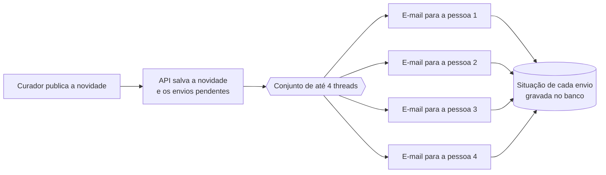

# Paralelismo e concorrência no Oráculo

Documento preparado para a conversa com o outro orientador, a pedido da orientadora, para confirmar se o conceito de paralelismo está aplicado no software. Na visão da equipe, **sim**: em várias camadas, com código, testes automatizados e uma medição de ganho no sistema real.

> **Situação:** conversa com o orientador **pendente**. As observações dele serão registradas aqui.

## Conceitos usados

- **Concorrência:** o sistema lida com várias tarefas no mesmo período, alternando entre elas (por exemplo, responder à tela enquanto um e-mail é enviado).
- **Paralelismo:** várias tarefas executam ao mesmo tempo, em threads ou máquinas diferentes.
- **Tarefas do Oráculo:** quase todas passam o tempo **esperando a rede** (banco de dados no Supabase, IA do Google Gemini, Gmail). Para esse tipo de tarefa, threads são a escolha adequada em Python: enquanto uma thread espera a resposta da rede, o interpretador libera as outras (o GIL é liberado durante a espera), e as esperas acontecem ao mesmo tempo. Processos separados só seriam necessários para cálculo pesado de CPU, que o sistema não tem.

## Onde o paralelismo está aplicado

| Camada | O que roda em paralelo ou de forma concorrente | Como | Onde está no código |
| --- | --- | --- | --- |
| **Servidor web** | Pedidos de várias pessoas ao mesmo tempo | O FastAPI executa cada rota em um conjunto de threads (até 40 por processo), então uma consulta lenta à IA não bloqueia as outras pessoas | Rotas em [`backend/app/rotas/`](../backend/app/rotas/) (funções `def`, executadas pelo FastAPI em threads) |
| **Envio das novidades por e-mail** | Os e-mails para cada pessoa que acompanha o tema | `ThreadPoolExecutor` com até 4 envios simultâneos; a falha de um envio não atrasa nem impede os outros | [`backend/app/rotas/atualizacoes.py`](../backend/app/rotas/atualizacoes.py) e [`backend/app/paralelo.py`](../backend/app/paralelo.py) |
| **Dashboard** | As 5 consultas ao banco que montam os indicadores (perguntas, pedidos, inscrições, usuários, atualizações) | As consultas são independentes e vão ao banco ao mesmo tempo | [`backend/app/rotas/relatorios.py`](../backend/app/rotas/relatorios.py) |
| **"Saber mais" em segundo plano** | O envio do e-mail e a tela | A tela recebe a confirmação na hora e acompanha a situação do pedido enquanto o servidor monta e envia o e-mail (tarefa em segundo plano) | [`backend/app/segundo_plano.py`](../backend/app/segundo_plano.py) e [`backend/app/rotas/consulta.py`](../backend/app/rotas/consulta.py) |
| **Interface (navegador)** | Requisições à API | A tela de sites e vídeos busca os links e os temas ao mesmo tempo (`Promise.all`) | [`frontend/src/paginas/painel/Materiais.jsx`](../frontend/src/paginas/painel/Materiais.jsx) |
| **Publicação (Vercel)** | Instâncias do backend | A Vercel cria várias instâncias da função conforme o número de acessos (escala horizontal) | [`vercel.json`](../vercel.json) |
| **Banco de dados** | Consultas de vários usuários | O PostgreSQL (Supabase) atende conexões simultâneas, com controle de concorrência próprio | [`supabase/`](../supabase/) |
| **Integração contínua** | Verificação do backend e do frontend | O GitHub Actions roda as duas verificações em máquinas separadas, ao mesmo tempo | [`.github/workflows/testes.yml`](../.github/workflows/testes.yml) |

## Exemplo: envio das novidades de um tema

O limite de 4 envios simultâneos é proposital: mais conexões ao mesmo tempo poderiam ser recusadas pelo Gmail.

## Medição no sistema real

As 5 consultas do dashboard, feitas ao banco real no Supabase (mediana de 5 execuções, 06/11/2026):

| Forma de execução | Tempo |
| --- | --- |
| Uma depois da outra | 0,99 s |
| Em paralelo | 0,43 s (**cerca de 2,3 vezes mais rápido**) |

## Como os testes comprovam

Os testes em [`backend/tests/test_paralelo.py`](../backend/tests/test_paralelo.py) usam uma **barreira** (`threading.Barrier`): ela só libera quando todas as tarefas estão rodando juntas. Se as tarefas fossem executadas uma de cada vez, a barreira nunca liberaria e o teste falharia por tempo. Os testes cobrem:

- a função que executa tarefas em paralelo devolve os resultados na ordem certa;
- as tarefas de fato rodam ao mesmo tempo;
- os e-mails de uma novidade são enviados aos inscritos em paralelo e cada envio fica registrado como "enviado".

Esses testes rodam automaticamente a cada envio ao GitHub.

## Cuidados tomados

- **Tarefas independentes:** cada thread trabalha com dados próprios (um e-mail, uma consulta), sem disputar a mesma variável.
- **Limite de threads:** o número de tarefas simultâneas é limitado, para não sobrecarregar o banco nem o Gmail.
- **Falhas isoladas:** um erro em uma thread fica registrado no log e na situação daquele envio, sem derrubar as demais.
- **Plano gratuito da IA:** as perguntas ao Gemini continuam uma de cada vez por pessoa, porque o plano gratuito limita o número de pedidos por minuto e por dia.
