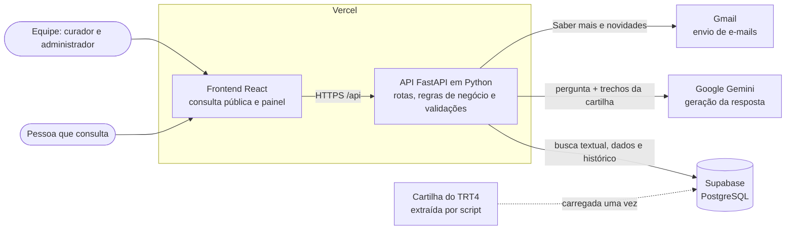
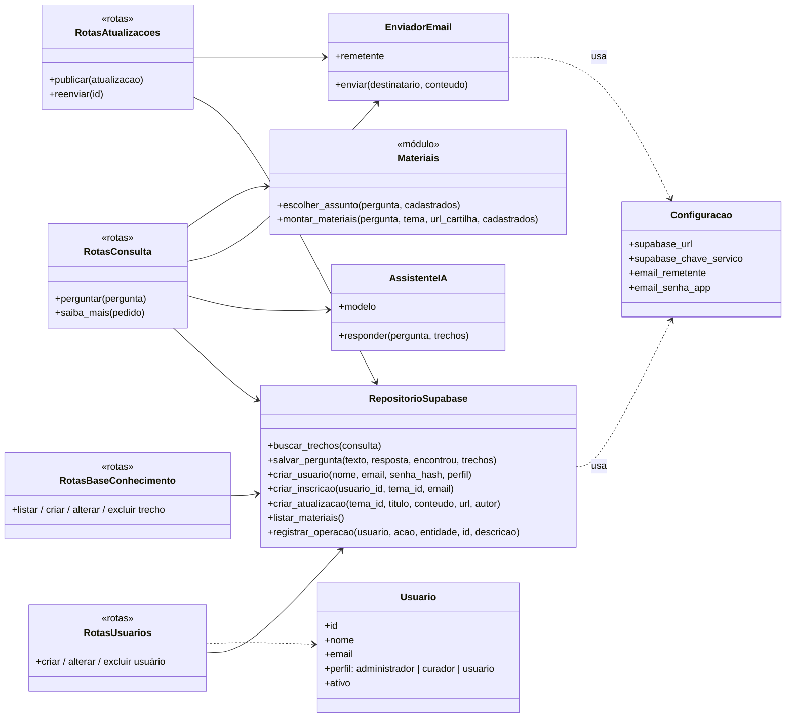
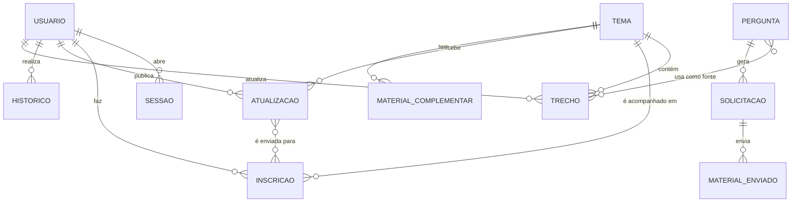
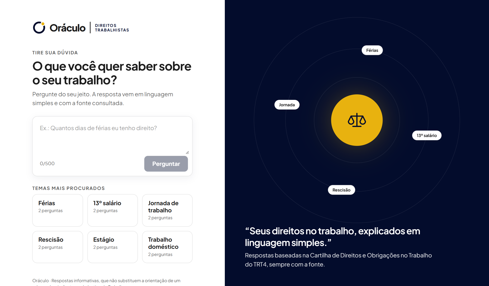

# Sprint 02 — Diagramas técnicos

[← Voltar à Sprint 02](README.md)

Os diagramas abaixo descrevem o sistema como ele está implementado. O GitHub desenha os blocos `mermaid` automaticamente, e o relatório em PDF usa os mesmos desenhos.

## 1. Arquitetura do sistema

O Oráculo segue uma arquitetura em camadas: a interface em React conversa apenas com a API em Python (FastAPI), que concentra as regras de negócio e é a única parte com acesso ao banco de dados, à IA e ao envio de e-mails. As chaves de acesso ficam só no backend.

**Fluxo da consulta (RAG):** a pergunta chega à API, que busca no banco os trechos mais relevantes da cartilha; a IA recebe só esses trechos e escreve a resposta; a API confere as fontes citadas, grava a pergunta para auditoria e devolve a resposta à tela.

## 2. Diagrama de classes

As principais classes do backend e como elas se relacionam. As rotas usam os serviços por injeção de dependência, o que permite trocar o banco, a IA e o e-mail por versões simuladas nos testes automatizados.

## 3. Modelo entidade-relacionamento (MER)

| Entidade | O que representa |
| --- | --- |
| Tema | Uma das 25 páginas da cartilha do TRT4 (Férias, Rescisão...) |
| Trecho | Um subtítulo da cartilha, usado como fonte das respostas |
| Pergunta | Pergunta feita na consulta, com a resposta gerada (sem dados pessoais) |
| Solicitação | Pedido de "Saber mais": nome, e-mail, autorização e situação do envio |
| Material enviado | Site ou vídeo enviado em cada solicitação |
| Material complementar | Sites e vídeos escolhidos pela equipe para cada assunto |
| Usuário | Conta com perfil administrador, curador ou usuário |
| Sessão | Login ativo de um usuário |
| Inscrição | Tema que um usuário acompanha |
| Atualização | Novidade publicada pela equipe sobre um tema |
| Histórico | Registro de cada operação: quem fez, o quê e quando |

## 4. Modelo relacional

Implementado no Supabase pelos scripts [`supabase/001`](../../../supabase/) a `007`. **PK** = chave primária; **FK** = chave estrangeira.

| Tabela | Colunas | Chaves |
| --- | --- | --- |
| `temas` | id, nome, slug, url, criado_em | PK id |
| `trechos` | id, tema_id, secao, ordem, texto, busca, atualizado_por, atualizado_em | PK id; FK tema_id → temas; FK atualizado_por → usuarios |
| `sinonimos` | termo, equivalentes | PK termo |
| `perguntas` | id, texto, resposta, encontrou, criado_em | PK id |
| `pergunta_trechos` | pergunta_id, trecho_id | PK (pergunta_id, trecho_id); FK → perguntas; FK → trechos |
| `solicitacoes_conteudo` | id, pergunta_id, nome, email, consentimento, status, erro, criado_em, enviado_em | PK id; FK pergunta_id → perguntas |
| `materiais_enviados` | id, solicitacao_id, tipo, titulo, url | PK id; FK solicitacao_id → solicitacoes_conteudo |
| `materiais_complementares` | id, tema_id, assunto, palavras_chave, tipo, titulo, url, ordem, criado_em | PK id; FK tema_id → temas |
| `usuarios` | id, nome, email, senha_hash, perfil, ativo, consentimento_email, criado_em, atualizado_em | PK id; e-mail único |
| `sessoes` | token_hash, usuario_id, criada_em, expira_em | PK token_hash; FK usuario_id → usuarios |
| `inscricoes_tema` | id, tema_id, usuario_id, email, consentimento, ativa, criado_em, cancelado_em | PK id; FK tema_id → temas; FK usuario_id → usuarios; único (tema, e-mail) |
| `atualizacoes` | id, tema_id, autor_id, titulo, conteudo, url, publicado_em | PK id; FK tema_id → temas; FK autor_id → usuarios |
| `envios_atualizacao` | atualizacao_id, inscricao_id, status, enviado_em | PK (atualizacao_id, inscricao_id); FK → atualizacoes; FK → inscricoes_tema |
| `historico_operacoes` | id, usuario_id, usuario_nome, acao, entidade, entidade_id, descricao, criado_em | PK id; FK usuario_id → usuarios |

**Segurança (RNF03):** todas as tabelas têm o acesso público bloqueado (RLS); só o backend, com a chave de serviço, lê e grava os dados. As senhas são guardadas apenas como hash (scrypt), e as sessões guardam só o hash do token.

## 5. Protótipos das telas

As telas foram construídas direto no sistema, que funciona como protótipo navegável. Os prints de cada tela estão nas Sprints [03](../sprint-03/README.md), [04](../sprint-04/README.md), [05](../sprint-05/README.md), [06](../sprint-06/README.md) e [07](../sprint-07/README.md).

