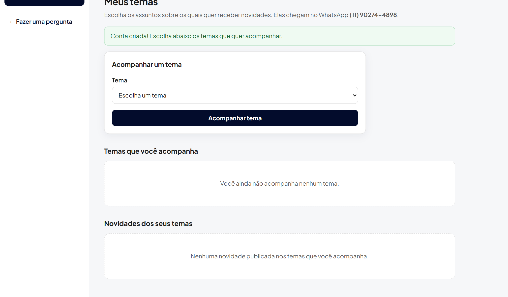
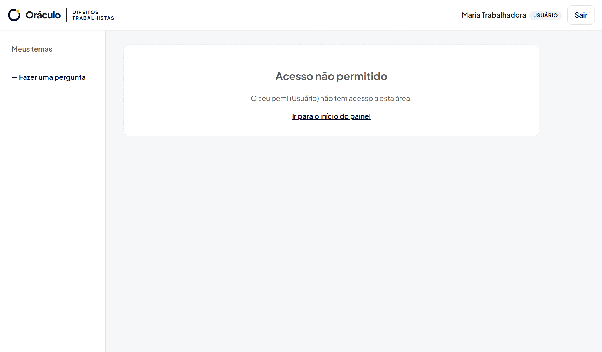
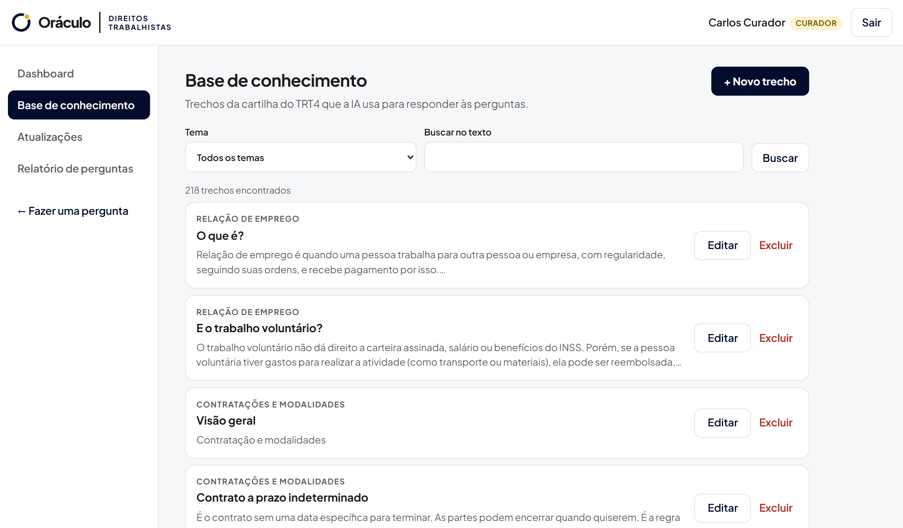
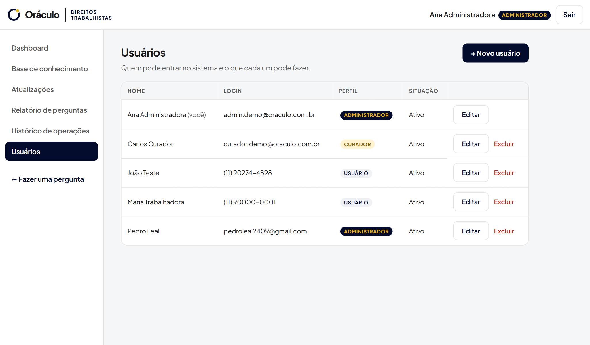

# Sprint 03 — Base funcional: login, perfis e CRUD

**Situação:** Concluída · [← Voltar ao índice](../../README.md)

## O que a Sprint pediu

Banco de dados conectado, login funcional, cadastro de usuários, controle de perfis, CRUD principal com persistência real e primeiro deploy local.

## O que foi entregue

| Item pedido | Entrega | Onde ver |
| --- | --- | --- |
| Banco conectado | A API lê e grava no Supabase; a conexão é refeita sozinha se cair | [`backend/app/repositorio.py`](../../../backend/app/repositorio.py) |
| Login funcional | Login com sessão guardada no banco (expira em 8 h); senha com hash scrypt | [`rotas/autenticacao.py`](../../../backend/app/rotas/autenticacao.py) · [`seguranca.py`](../../../backend/app/seguranca.py) |
| Cadastro de usuários | Cadastro público e cadastro pelo administrador | [`rotas/usuarios.py`](../../../backend/app/rotas/usuarios.py) · tela **Usuários** |
| Controle de perfis | **Administrador** (tudo), **Curador** (base de conhecimento e relatórios), **Usuário** (acompanha temas) | [`dependencias.py`](../../../backend/app/dependencias.py) · menu do painel |
| CRUD principal | Base de conhecimento: cadastrar, consultar (filtro e paginação), editar e excluir trechos da cartilha | [`rotas/base_conhecimento.py`](../../../backend/app/rotas/base_conhecimento.py) · tela **Base de conhecimento** |
| Deploy local | Um comando instala, compila e abre o sistema em `http://localhost:8000` | [`iniciar.bat`](../../../iniciar.bat) · [`iniciar.sh`](../../../iniciar.sh) |

## Ajustes desta Sprint

| Commit | O que mudou |
| --- | --- |
| [`5b2f043`](https://github.com/PedroHTLeal/oraculo_direitos_trabalhistas_8na/commit/5b2f043) | API organizada em módulos e erros de validação traduzidos para o português |
| [`2d3ccea`](https://github.com/PedroHTLeal/oraculo_direitos_trabalhistas_8na/commit/2d3ccea) | Login, cadastro de usuários e controle de perfis |
| [`4f0a442`](https://github.com/PedroHTLeal/oraculo_direitos_trabalhistas_8na/commit/4f0a442) | CRUD da base de conhecimento, auditoria de perguntas e acompanhamento de temas |
| [`e5c21bf`](https://github.com/PedroHTLeal/oraculo_direitos_trabalhistas_8na/commit/e5c21bf) | Telas de login, cadastro e painel administrativo |
| [`d9f800e`](https://github.com/PedroHTLeal/oraculo_direitos_trabalhistas_8na/commit/d9f800e) | Deploy local: o backend serve o site compilado; scripts de execução |

## Evidências

Prints gerados em 02/11/2026 pelo roteiro automatizado [`capturar_evidencias.py`](../../ferramentas/capturar_evidencias.py), com o sistema rodando localmente e o banco real no Supabase. Todos os prints estão em [`docs/evidencias/`](../../evidencias/).

**Login: campos obrigatórios**

**Login: e-mail ou senha incorretos**

**Cadastro concluído (conta gravada no banco)**

**Controle de perfis: usuário comum sem acesso à base**

**CRUD: consulta da base de conhecimento (dados do Supabase)**

**Gestão de usuários e perfis (administrador)**

## Como executar localmente

1. Configure as contas e o arquivo `backend/.env` ([guia](../../configuracao.md)).
2. Rode `iniciar.bat` (Windows) ou `./iniciar.sh` (Linux/macOS).
3. Crie o primeiro administrador: `backend\.venv\Scripts\python backend\scripts\criar_administrador.py`.

## Mudanças em relação ao planejado

- O login foi implementado no próprio banco (tabela de usuários e sessões), em vez do Supabase Auth, para que o login, os perfis e as sessões fiquem integrados às tabelas do projeto.
- A consulta pública continua sem login (RF01); a conta é usada pela equipe e por quem quer acompanhar temas e receber as novidades por e-mail (ver [Sprint 05](../sprint-05/README.md)).
