# Sprint 04 — Módulo 1: gestão da base de conhecimento

**Situação:** Concluída e testada com o banco real · [← Voltar ao índice](../../README.md)

## O que a Sprint pediu

Primeiro módulo totalmente funcional, com persistência de dados, validações, mensagens de erro claras, navegação entre telas e commits organizados.

## Módulo entregue: gestão da base de conhecimento

A equipe (administradores e curadores) mantém os trechos da cartilha que a IA usa para responder.

**Fluxo completo:** entrar → ver a base (filtrar por tema e pesquisar no texto) → cadastrar um trecho → editar → excluir com confirmação. Tudo fica gravado no Supabase e continua disponível depois de fechar e abrir o sistema.

## O que foi entregue

| Item pedido | Entrega | Exemplos |
| --- | --- | --- |
| Módulo funcional | CRUD da base de conhecimento ligado ao banco, com os sinônimos da busca e os sites e vídeos do "Saber mais" | Telas **Base de conhecimento**, **Sinônimos da busca** e **Sites e vídeos** |
| Persistência | Dados no Supabase (PostgreSQL); o roteiro de evidências reinicia o sistema e confere que o trecho continua salvo | [`docs/ferramentas/capturar_evidencias.py`](../../ferramentas/capturar_evidencias.py) |
| Validações | No navegador (antes de enviar) e no servidor (regras iguais) | Subtítulo de 2 a 200 caracteres; texto de 10 a 5000; tema existente; e-mail válido; senha com no mínimo 8 caracteres |
| Mensagens de erro | Erros técnicos viram frases em português, junto do campo | "Preencha o campo subtítulo.", "Escolha um tema válido.", "Sem conexão com o servidor..." |
| Navegação | Rotas com menu por perfil; sem login vai para Entrar; perfil sem permissão vê um aviso; página 404 | [`frontend/src/App.jsx`](../../../frontend/src/App.jsx) |
| Commits organizados | Um commit por ajuste, com data, objetivo, o que foi feito e como agrega | [Histórico no GitHub](https://github.com/PedroHTLeal/oraculo_direitos_trabalhistas_8na/commits/main) |

## Ajustes desta Sprint

| Commit | O que mudou |
| --- | --- |
| [`5b2f043`](https://github.com/PedroHTLeal/oraculo_direitos_trabalhistas_8na/commit/5b2f043) | Tradução das mensagens de validação para o usuário |
| [`e5c21bf`](https://github.com/PedroHTLeal/oraculo_direitos_trabalhistas_8na/commit/e5c21bf) | Navegação do painel, validações nos formulários e confirmação antes de excluir |
| [`4165443`](https://github.com/PedroHTLeal/oraculo_direitos_trabalhistas_8na/commit/4165443) | Repetição automática quando a conexão com o banco cai; mensagem clara para erros inesperados |

## Evidências

Prints gerados em 02/11/2026 pelo roteiro automatizado [`capturar_evidencias.py`](../../ferramentas/capturar_evidencias.py), com o sistema rodando localmente e o banco real no Supabase. Todos os prints estão em [`docs/evidencias/`](../../evidencias/).

**Sinônimos da busca: palavras do dia a dia traduzidas para os termos da cartilha**

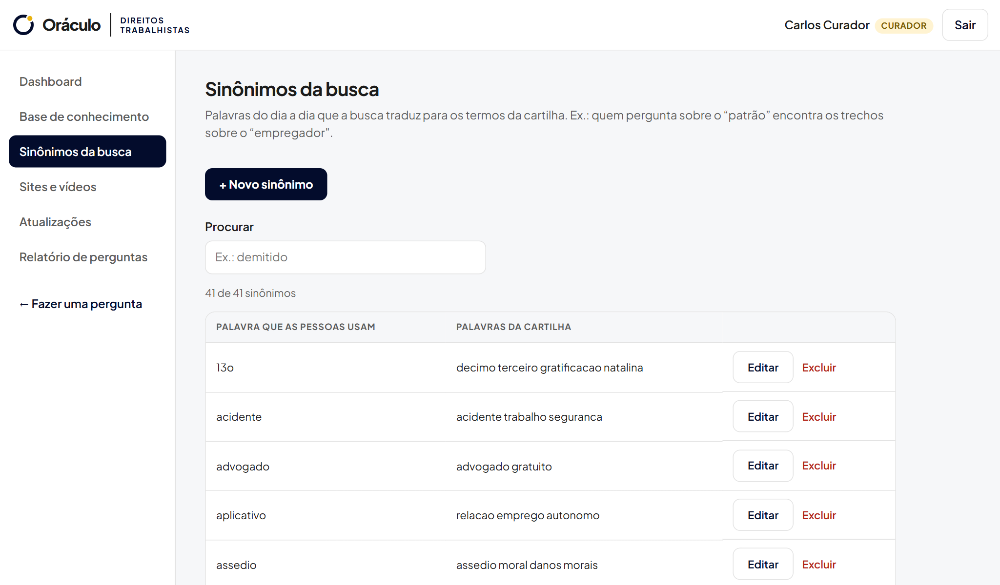

**Sites e vídeos do "Saber mais", agrupados por assunto**

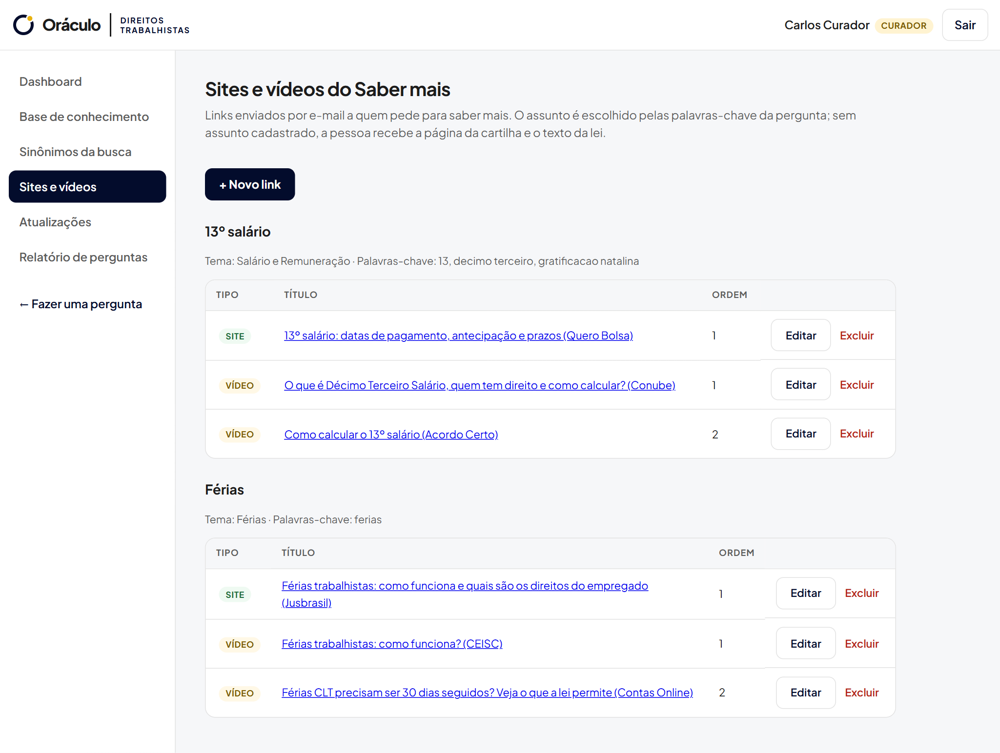

**Validação do cadastro de um link**

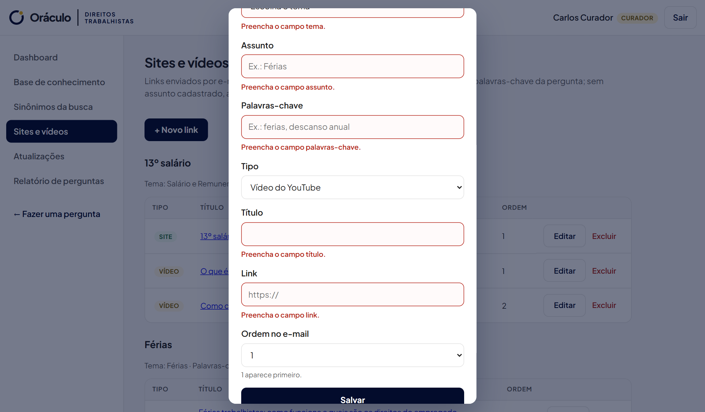

**Consulta com filtro por tema e pesquisa no texto**

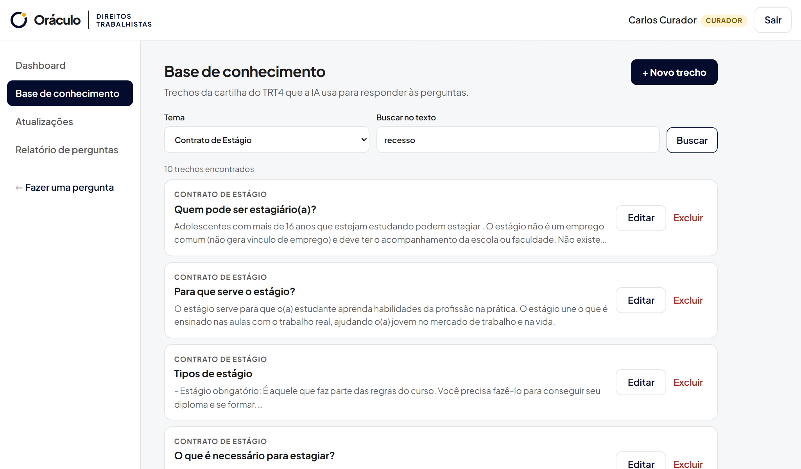

**Validação: campos obrigatórios do trecho**

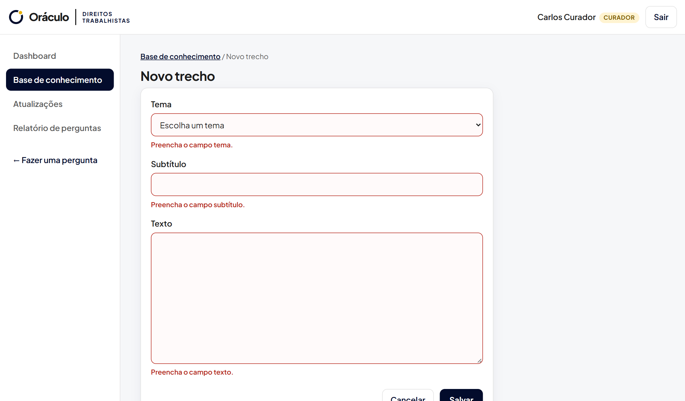

**Cadastrar: trecho gravado e encontrado na pesquisa**

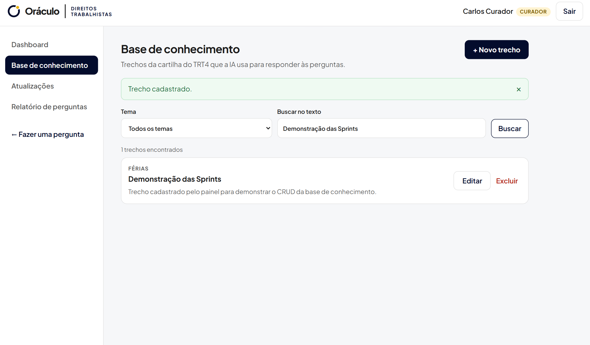

**Atualizar: edição do trecho**

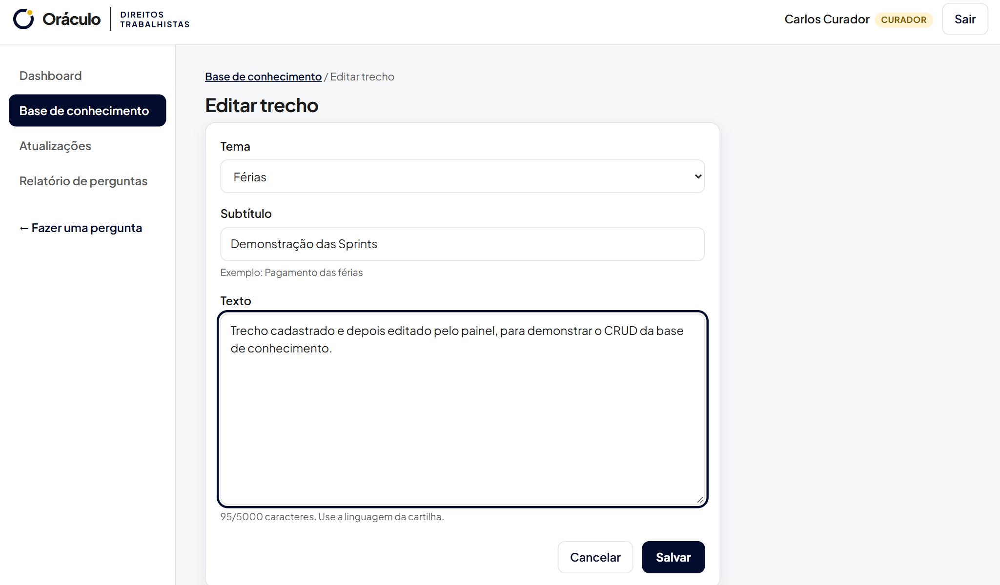

**Mensagem de sucesso após salvar**

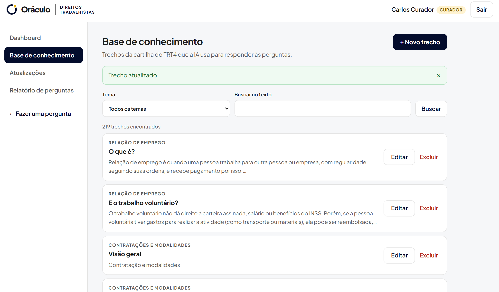

**Persistência: o trecho continua salvo depois de fechar e abrir o sistema**

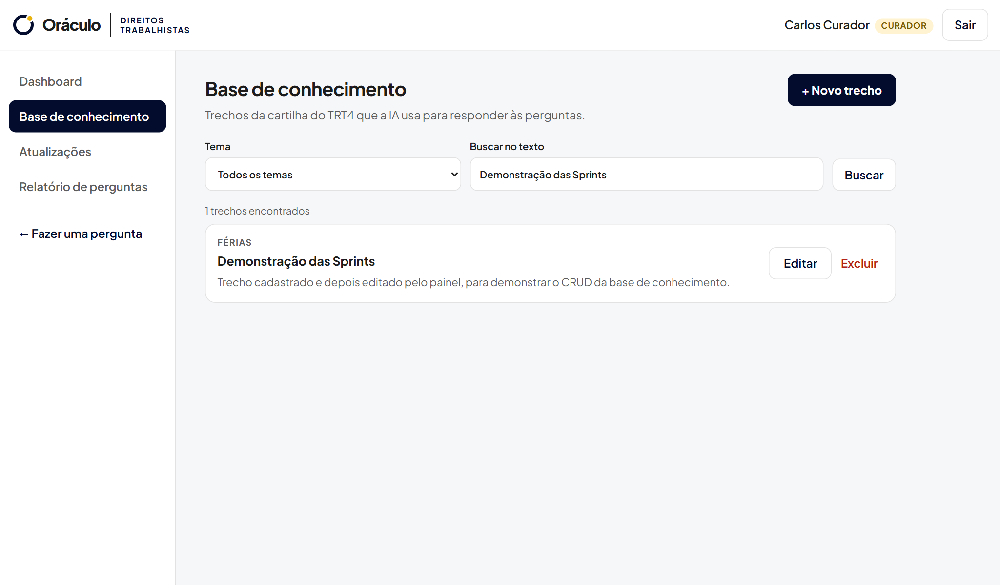

**Excluir: confirmação antes de apagar**

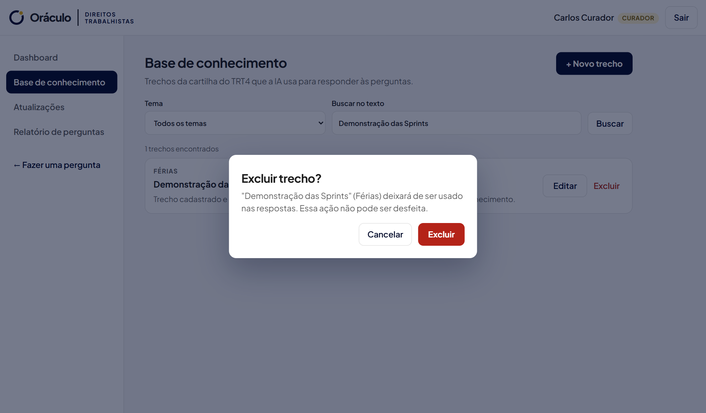

**Excluir: trecho removido**

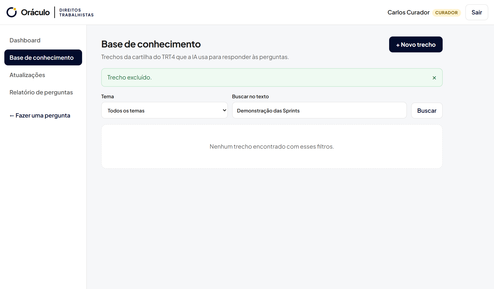

**Mensagens de erro junto de cada campo**

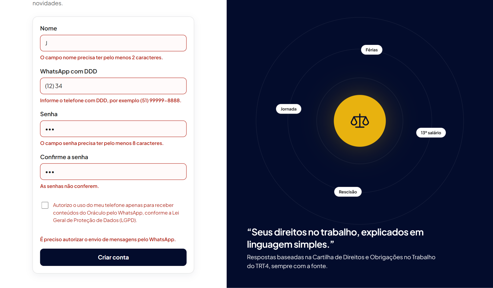

**Navegação no celular**

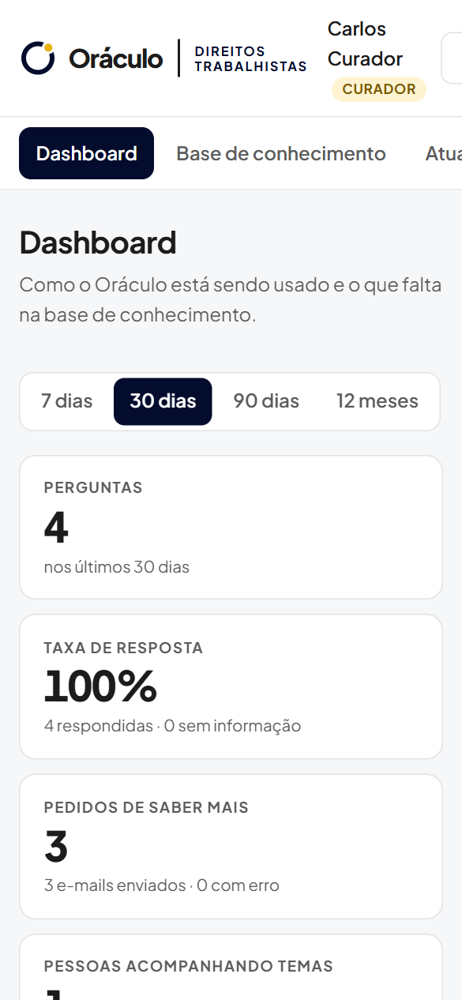

