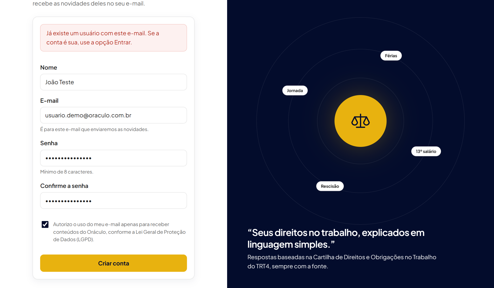
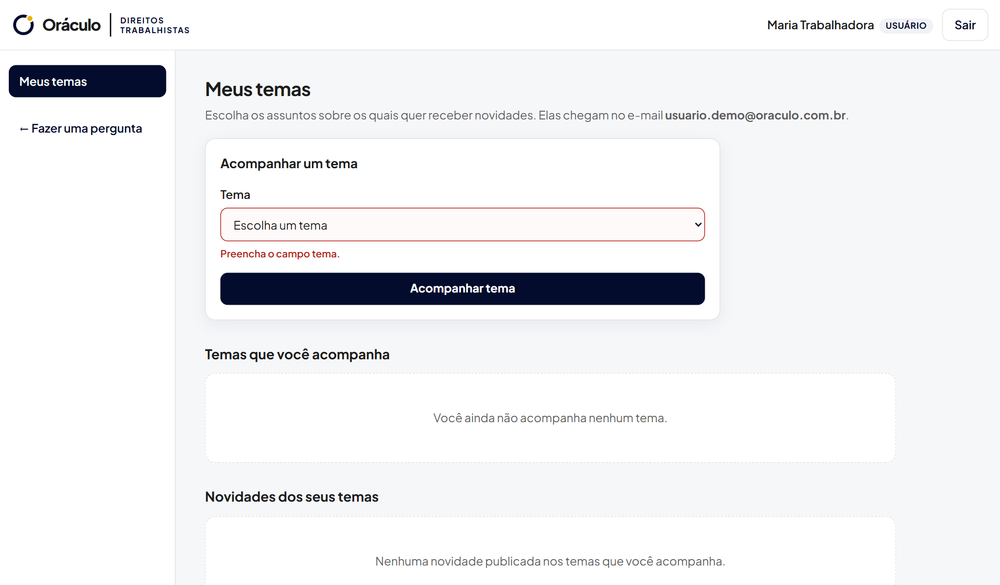
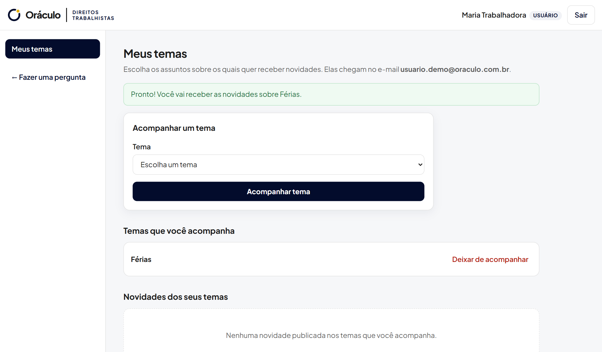
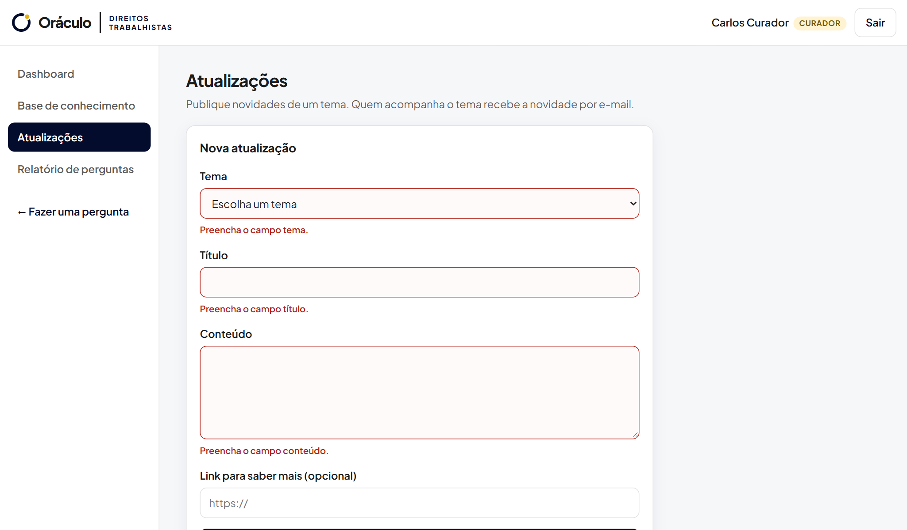
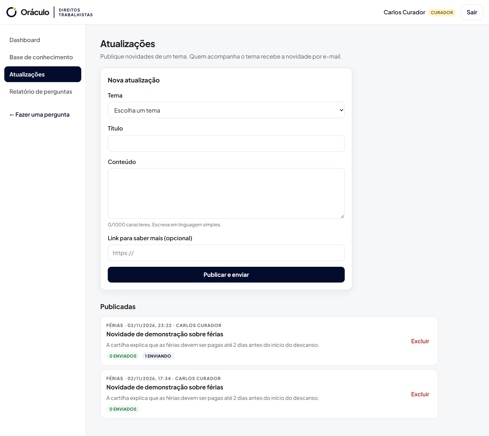
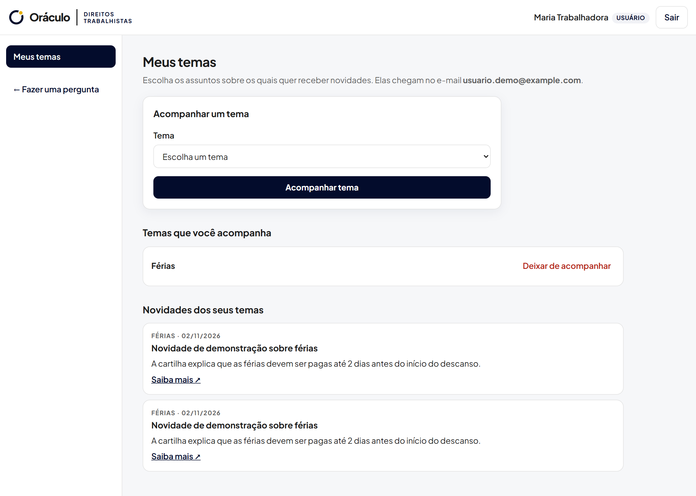

# Sprint 05 — Módulo 2: acompanhamento de temas

**Situação:** Concluída e testada com o banco real e com o envio real de e-mail · [← Voltar ao índice](../../README.md)

## O que a Sprint pediu

Segundo módulo completo, integrado ao banco de dados, com regras de negócio atualizadas, testes das funcionalidades e correção dos bugs encontrados.

## Módulo entregue: acompanhamento de temas por e-mail

**Fluxo completo:** a pessoa cria a conta com o e-mail → escolhe temas para acompanhar → a equipe publica uma atualização do tema → o sistema envia um e-mail a cada inscrito e registra a situação de cada envio → a pessoa também vê a novidade em **Meus temas**.

## O que foi entregue

| Item pedido | Entrega | Onde ver |
| --- | --- | --- |
| Segundo módulo | Conta com e-mail, temas acompanhados e atualizações | Telas **Crie sua conta**, **Meus temas** e **Atualizações** |
| Integração com o banco | Tabelas `usuarios`, `inscricoes_tema`, `atualizacoes` e `envios_atualizacao` | [`supabase/003_modelo_relacional.sql`](../../../supabase/003_modelo_relacional.sql) e [`006_contato_por_email.sql`](../../../supabase/006_contato_por_email.sql) |
| Regras de negócio | Ver tabela abaixo | [`rotas/atualizacoes.py`](../../../backend/app/rotas/atualizacoes.py) |
| Testes | Testes automatizados no backend (`pytest`), 88 no total na versão atual | [`backend/tests/`](../../../backend/tests/) |
| Correção de bugs | Ver tabela de bugs abaixo | — |

### Regras de negócio implementadas ou atualizadas

| Regra | Justificativa |
| --- | --- |
| O cadastro público usa **nome, e-mail e senha**, com autorização obrigatória (LGPD) | A conta existe para a pessoa acompanhar temas e receber as novidades por e-mail |
| Todos entram com **e-mail e senha** | Um único jeito de entrar, simples para todos os perfis |
| Só recebem a atualização as **inscrições ativas** do tema no momento da publicação | Evita e-mails a quem deixou de acompanhar |
| O **curador só exclui as próprias** publicações; o administrador exclui qualquer uma | Responsabilidade sobre o que foi publicado |
| A publicação é salva **mesmo sem o e-mail configurado**; os envios ficam com erro e podem ser reenviados | Nenhuma informação se perde por falha externa |
| Uma pessoa não acompanha o mesmo tema duas vezes | Evita e-mails duplicados |

### Bugs encontrados e corrigidos

| Bug | Causa | Correção |
| --- | --- | --- |
| A busca não encontrava "estágio" nem com a palavra exata | A função SQL processava as palavras da pergunta duas vezes | Função corrigida ([`002`](../../../supabase/002_corrige_busca_e_sinonimos.sql)) |
| "Demitido", "patrão" e "FGTS" não achavam os temas certos | A cartilha usa outras palavras ("dispensa", "empregador") | Tabela de sinônimos editável |
| Erro 500 intermitente ao abrir a base | O Supabase encerra conexões paradas | Repetição automática da operação ([`4165443`](https://github.com/PedroHTLeal/oraculo_direitos_trabalhistas_8na/commit/4165443)) |
| Cadastros de teste recusados | O validador de e-mail não aceita o domínio reservado `.test` | Testes com domínio válido |
| Filtro de período do dashboard sempre recusado | O valor chega como texto e não era convertido | Validação própria com mensagem clara |

O registro completo de bugs, incluindo os encontrados depois, está na [Sprint 09](../sprint-09/README.md#bugs-encontrados-e-corrigidos).

## Evidências

Prints gerados em 02/11/2026 pelo roteiro automatizado [`capturar_evidencias.py`](../../ferramentas/capturar_evidencias.py), com o sistema rodando localmente e o banco real no Supabase. Todos os prints estão em [`docs/evidencias/`](../../evidencias/).

**Regra: não pode haver duas contas com o mesmo e-mail**

**Meus temas: validação**

**Meus temas: tema acompanhado (gravado no banco)**

**Atualizações: validação do formulário**

**Atualização publicada; sem o e-mail configurado o envio fica com erro e pode ser reenviado**

**A pessoa vê a novidade do tema que acompanha**

## Ajustes desta Sprint

| Commit | O que mudou |
| --- | --- |
| [`43414b5`](https://github.com/PedroHTLeal/oraculo_direitos_trabalhistas_8na/commit/43414b5) | Cadastro e login da conta; "Saiba mais" e temas ligados à conta |
| [`7f76733`](https://github.com/PedroHTLeal/oraculo_direitos_trabalhistas_8na/commit/7f76733) | Telas de conta e "Saiba mais" com criar conta / entrar |
| [`7f43866`](https://github.com/PedroHTLeal/oraculo_direitos_trabalhistas_8na/commit/7f43866) | Módulo 2 no backend: publicar, enviar, reenviar e excluir atualizações |
| [`e24c793`](https://github.com/PedroHTLeal/oraculo_direitos_trabalhistas_8na/commit/e24c793) | Telas do Módulo 2: Atualizações e novidades em Meus temas |
