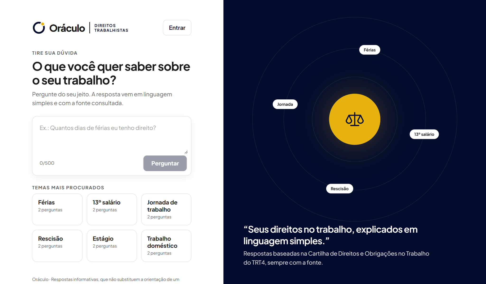
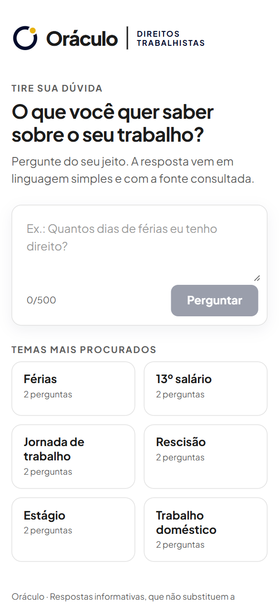
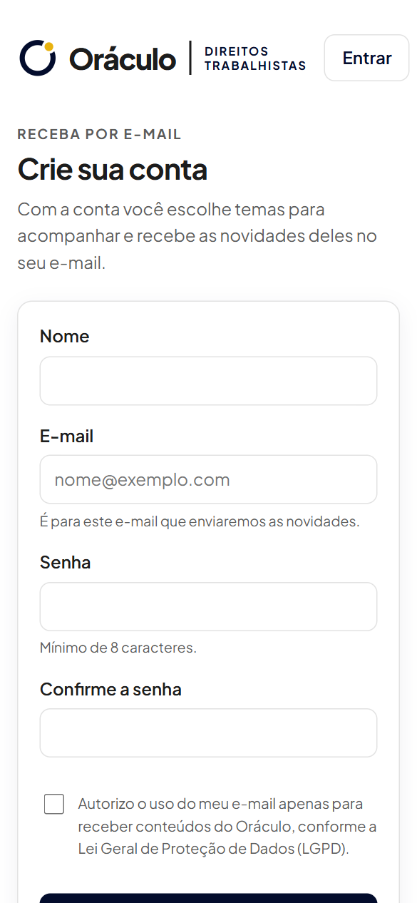

# Sprint 06 — Módulo 3, integração e melhorias de interface

**Situação:** Em andamento: módulo 3 e integração prontos no código; aguarda as observações da Pré-Banca e a chave do Gemini · [← Voltar ao índice](../../README.md)

## O que a Sprint pediu

Correções apontadas na Pré-Banca, terceiro módulo implementado, integração entre os módulos, melhorias na interface e ajustes de navegação.

## Módulo entregue: consulta inteligente (componente de IA)

**Fluxo:** a pessoa faz a pergunta → o sistema busca os trechos mais relevantes da cartilha no Supabase → a IA (Google Gemini) escreve a resposta usando só esses trechos → a resposta aparece com as fontes → em "Quer saber mais? Sim", a pessoa informa nome e e-mail e recebe a resposta, 2 sites e 2 vídeos.

## Integração entre os módulos

| De | Para | Como |
| --- | --- | --- |
| Módulo 1 (base de conhecimento) | Módulo 3 (consulta) | Todo trecho cadastrado ou editado pela equipe passa a ser usado pela IA nas respostas |
| Módulo 3 (consulta) | Módulo 1 (base) | Perguntas sem resposta aparecem no Dashboard e no relatório com o botão **Incluir na base** |
| Módulo 2 (conta) | Módulo 3 (consulta) | Quem já entrou na conta tem o nome e o e-mail preenchidos no "Saber mais"; quem não tem conta só informa nome e e-mail |
| Todos | Histórico e Dashboard | Operações registradas no histórico e somadas nos indicadores ([Sprint 07](../sprint-07/README.md)) |

## O que foi entregue

| Item pedido | Situação |
| --- | --- |
| Correções da Pré-Banca | **Pendente:** aguardando as observações recebidas pela equipe |
| Terceiro módulo | Implementado; a geração de respostas aguarda a chave gratuita do Gemini no `backend/.env` |
| Integração entre módulos | Concluída (tabela acima) |
| Melhorias na interface | Abaixo da resposta, no painel azul (com o símbolo da órbita), o convite **"Quer saber mais sobre o assunto?"** com o botão **Sim**; ao clicar, abre a janela **Saber mais**, que explica o que será enviado e pede só nome, e-mail e a autorização (LGPD); menu por perfil |
| Ajustes de navegação | Cada perfil começa pela sua área (equipe → Dashboard, usuário → Meus temas); depois de sair, a próxima pessoa não é mais levada à página da anterior (bug B06); "Meus temas" só aparece para quem tem conta de usuário |

## Evidências

Prints gerados em 02/11/2026 pelo roteiro automatizado [`capturar_evidencias.py`](../../ferramentas/capturar_evidencias.py), com o sistema rodando localmente e o banco real no Supabase. Todos os prints estão em [`docs/evidencias/`](../../evidencias/).

**Consulta: tela inicial com o painel de órbita**

**Consulta no celular**

**Cadastro no celular**

A resposta gerada pela IA (no painel azul, com o convite "Quer saber mais sobre o assunto? Sim") ainda não tem print com dados reais: depende da chave gratuita do Gemini no `backend/.env`.

## Ajustes desta Sprint

| Commit | O que mudou |
| --- | --- |
| [`10f67db`](https://github.com/PedroHTLeal/oraculo_direitos_trabalhistas_8na/commit/10f67db) | Busca na base, resposta com IA e "Saiba mais" |
| [`231dc75`](https://github.com/PedroHTLeal/oraculo_direitos_trabalhistas_8na/commit/231dc75) | IA trocada pelo Google Gemini gratuito (projeto sem custo) |
| [`7f76733`](https://github.com/PedroHTLeal/oraculo_direitos_trabalhistas_8na/commit/7f76733) | "Saiba mais" integrado à conta |
| [`04f09ab`](https://github.com/PedroHTLeal/oraculo_direitos_trabalhistas_8na/commit/04f09ab) | Integração "Incluir na base" a partir das perguntas sem resposta; menu por perfil |
| [`ad724c3`](https://github.com/PedroHTLeal/oraculo_direitos_trabalhistas_8na/commit/ad724c3) | Correção do redirecionamento depois de sair do sistema |
| [`d916d51`](https://github.com/PedroHTLeal/oraculo_direitos_trabalhistas_8na/commit/d916d51) | Convite "Quer saber mais sobre o assunto? Sim" com explicação antes do cadastro |

## Mudanças em relação ao planejado

O histórico completo das alternativas testadas está no [registro de decisões](../../decisoes.md).

- **IA:** a primeira versão usava o Claude (Anthropic), que é pago; foi trocado pelo **Google Gemini** no plano gratuito, para atender ao RNF09 (custo operacional).
- **Links e vídeos:** são escolhidos e conferidos pela equipe, por assunto (tabela `materiais_complementares`), sem pesquisa automática; assim os endereços são sempre reais e o envio não depende de cota de API. A primeira versão tem férias e 13º salário.
- **Conteúdo complementar:** enviado **por e-mail** pelo Gmail, de graça, sem exigir conta: a pessoa informa só o nome e o e-mail (decisão da equipe, por ser o caminho mais simples para quem usa e para quem mantém o sistema).
