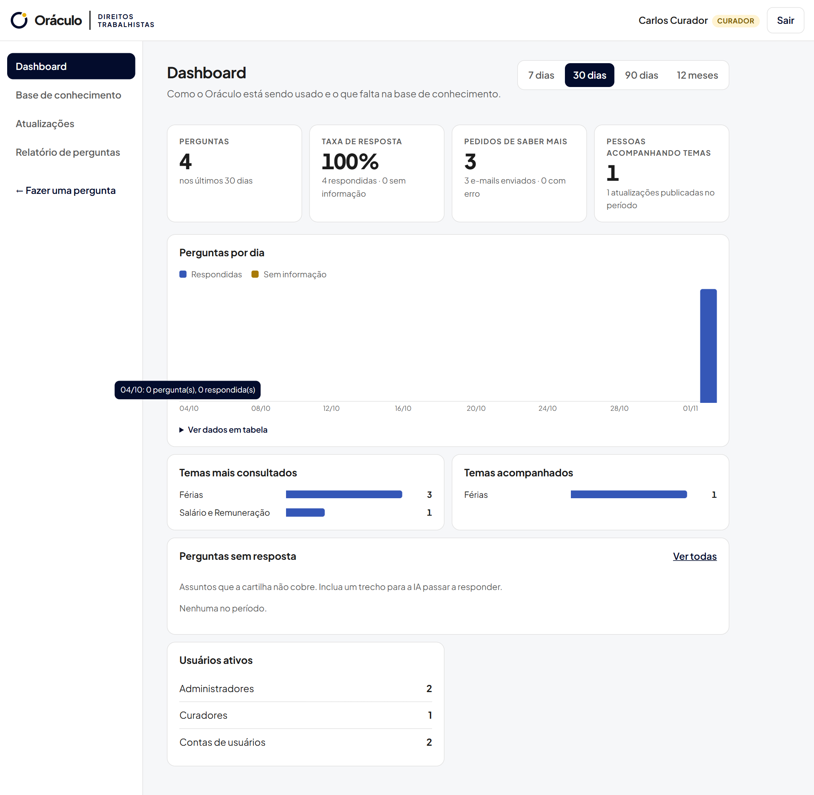
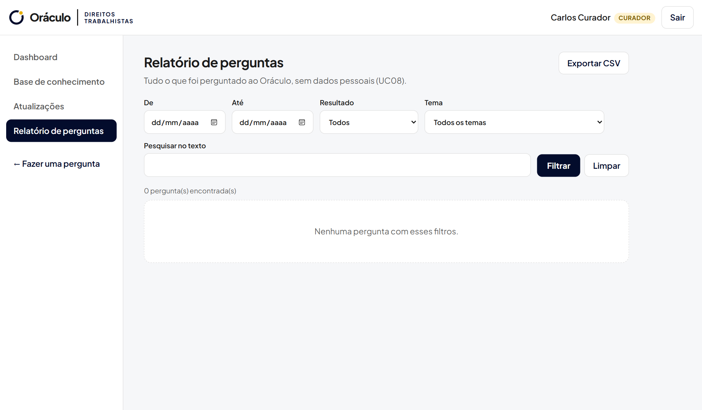
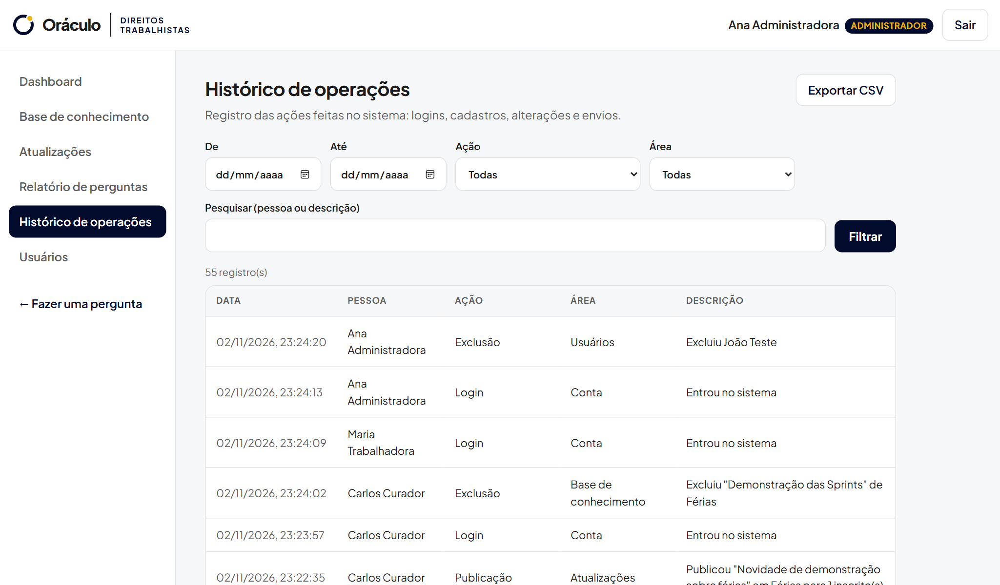
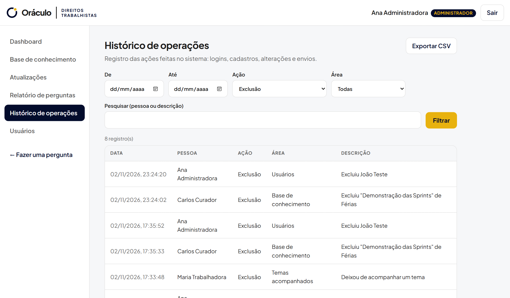
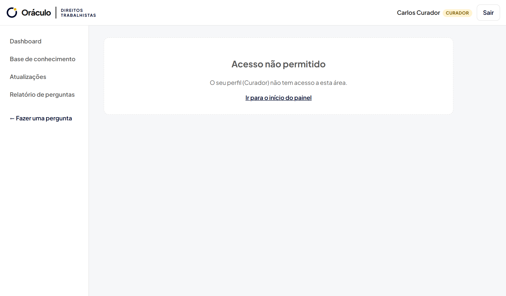

# Sprint 07 — Dashboard, relatórios, filtros, exportação e histórico

**Situação:** Concluída e testada com o banco real · [← Voltar ao índice](../../README.md)

## O que a Sprint pediu

Dashboard com dados reais, relatórios, pesquisas, filtros, exportação (quando aplicável) e logs ou histórico de operações.

## O que foi entregue

| Item pedido | Entrega | Onde ver |
| --- | --- | --- |
| Dashboard | Indicadores (perguntas, taxa de resposta, pedidos de Saber mais, pessoas acompanhando temas), gráfico de perguntas por data, temas mais consultados, temas acompanhados, perguntas sem resposta e usuários por perfil | Tela **Dashboard** · [`rotas/relatorios.py`](../../../backend/app/rotas/relatorios.py) |
| Relatórios | Relatório de perguntas e relatório do histórico de operações | Telas **Relatório de perguntas** e **Histórico de operações** |
| Pesquisas | Pesquisa no texto das perguntas, dos trechos da base e do histórico (pessoa ou descrição) | Campos "Pesquisar" de cada tela |
| Filtros | Período (de/até ou 7, 30, 90 dias e 12 meses), resultado, tema, ação e área | Barra de filtros de cada tela |
| Exportação | **CSV** com separador `;` e acentuação correta, que abre direto no Excel | Botão **Exportar CSV** |
| Histórico de operações | Logins, cadastros, inclusões, alterações, exclusões, publicações e pedidos de conteúdo por e-mail, com quem fez e quando | [`supabase/005_historico_de_operacoes.sql`](../../../supabase/005_historico_de_operacoes.sql) · [`historico.py`](../../../backend/app/historico.py) |

## Decisões

- **Exportação em CSV, e não em PDF:** os relatórios são tabelas que a equipe tende a analisar e filtrar em planilhas; o CSV abre no Excel e no Google Planilhas sem perder dados.
- **Histórico só para o administrador:** ele mostra ações de todas as pessoas; o curador vê o dashboard e o relatório de perguntas, que não têm dados pessoais.
- **Falha no histórico não bloqueia a operação:** se o registro falhar, a ação do usuário continua e o erro vai para o log do servidor.
- **Gráficos:** cores validadas para contraste e daltonismo, dica ao passar o mouse e a opção "Ver dados em tabela" para acessibilidade.

## Evidências

Prints gerados em 02/11/2026 pelo roteiro automatizado [`capturar_evidencias.py`](../../ferramentas/capturar_evidencias.py), com o sistema rodando localmente e o banco real no Supabase. Todos os prints estão em [`docs/evidencias/`](../../evidencias/).

**Dashboard com filtro de período e dados reais**

**Relatório de perguntas com filtros e exportação**

**Histórico de operações**

**Histórico filtrado pela ação "Exclusão"**

**Histórico restrito ao administrador**

Arquivos exportados no teste: [`historico-de-operacoes.csv`](../../evidencias/historico-de-operacoes.csv) e [`relatorio-perguntas.csv`](../../evidencias/relatorio-perguntas.csv) (este só com o cabeçalho, porque sem a chave do Gemini nenhuma pergunta foi respondida ainda).

## Ajustes desta Sprint

| Commit | O que mudou |
| --- | --- |
| [`57ad47c`](https://github.com/PedroHTLeal/oraculo_direitos_trabalhistas_8na/commit/57ad47c) | Backend: indicadores, relatórios com filtros, CSV e histórico de operações |
| [`04f09ab`](https://github.com/PedroHTLeal/oraculo_direitos_trabalhistas_8na/commit/04f09ab) | Telas: Dashboard, relatórios, histórico e exportação |
