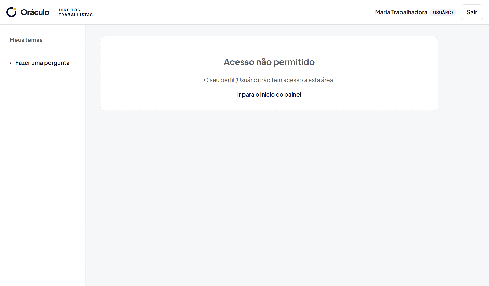
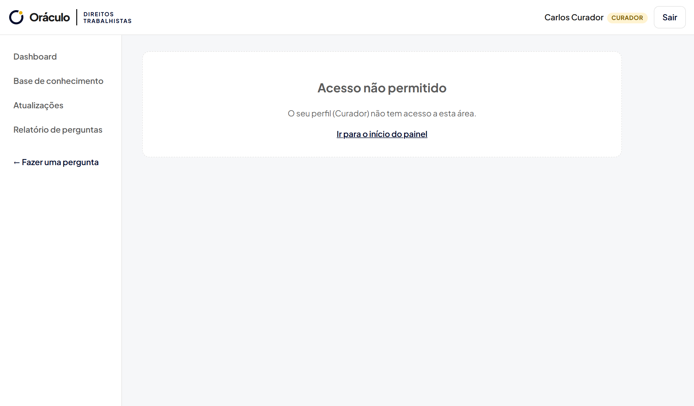
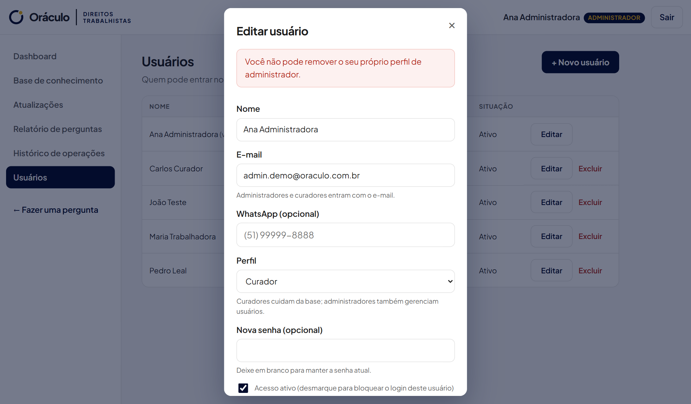

# Sprint 08 — Consolidação: permissões, usabilidade e regras de negócio

**Situação:** Em andamento · [← Voltar ao índice](../../README.md)

## O que a Sprint pediu

Todas as funcionalidades previstas implementadas, controle de permissões revisado, melhorias de usabilidade, revisão geral das regras de negócio e registro das mudanças de escopo.

## Controle de permissões (situação atual)

| Funcionalidade | Visitante | Usuário | Curador | Administrador |
| --- | :---: | :---: | :---: | :---: |
| Fazer perguntas e ver respostas | Sim | Sim | Sim | Sim |
| Receber "Saber mais" por e-mail | Sim | Sim | Sim | Sim |
| Acompanhar temas e ver novidades | — | Sim | — | — |
| Dashboard e relatório de perguntas | — | — | Sim | Sim |
| Base de conhecimento (CRUD) | — | — | Sim | Sim |
| Publicar atualizações | — | — | Sim | Sim |
| Excluir atualizações | — | — | Só as próprias | Todas |
| Histórico de operações | — | — | — | Sim |
| Gestão de usuários e perfis | — | — | — | Sim |

As permissões são verificadas **no servidor**, em cada rota: o menu só esconde o que a pessoa não pode usar, mas o bloqueio real acontece na API (erro 401 sem login e 403 sem permissão). Os testes automatizados cobrem acessos permitidos e negados para cada perfil.

## Evidências de permissões

**Usuário comum tentando abrir a base de conhecimento**

**Curador tentando abrir o histórico (exclusivo do administrador)**

**Regra: o sistema não pode ficar sem administrador ativo**

## Requisitos da Sprint 01

| Requisito | Situação |
| --- | --- |
| RF01 a RF03 (consulta sem conta, sugestões, pergunta livre) | Implementados |
| RF04 a RF09 (RAG, resposta simples, fontes, conteúdo original, sem informação) | Implementados; a geração depende da chave do Gemini |
| RF10 e RF11 (conteúdo complementar por e-mail) | Implementados; o envio é feito pelo Gmail |
| RF12 e RF13 (acompanhar temas e receber atualizações) | Implementados (Módulo 2) |
| RF14 (área administrativa) | Implementado (painel com perfis) |

## Pendências

- Revisão de usabilidade com o público-alvo e registro das melhorias.
- Revisão final das regras de negócio após os testes com os serviços reais.
- Registro das mudanças de escopo no documento da Sprint.
