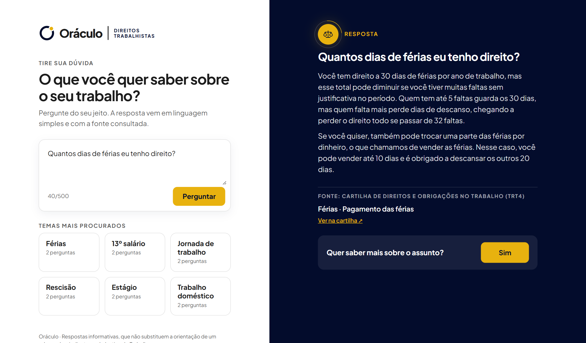
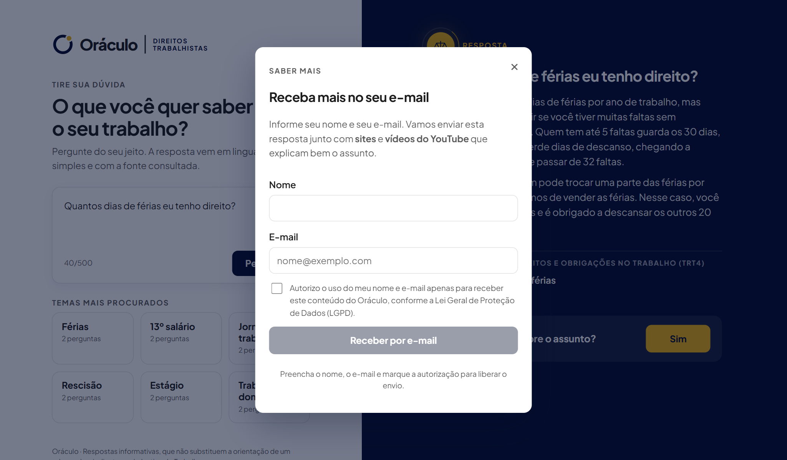
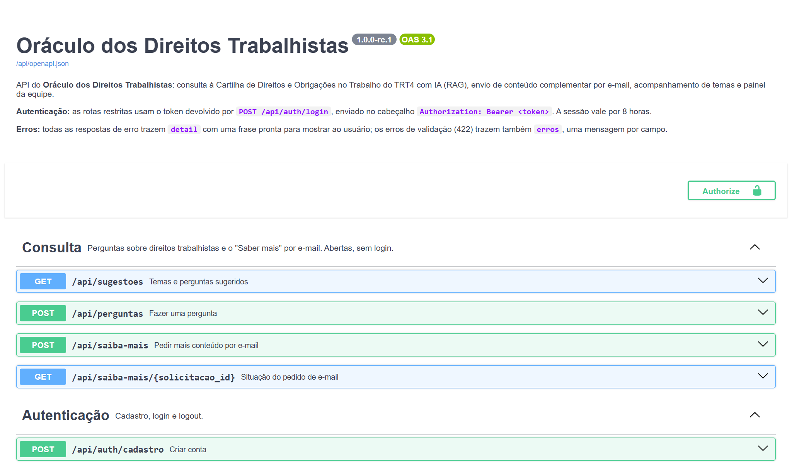
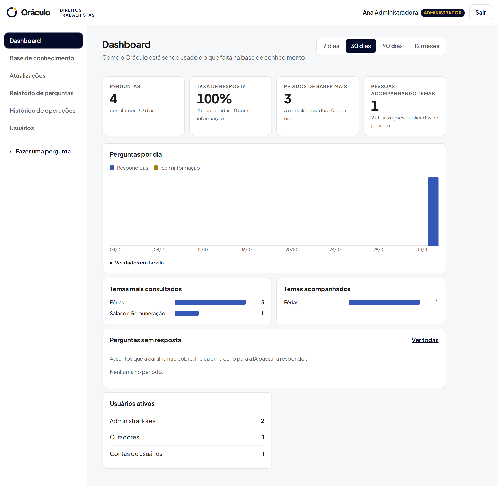
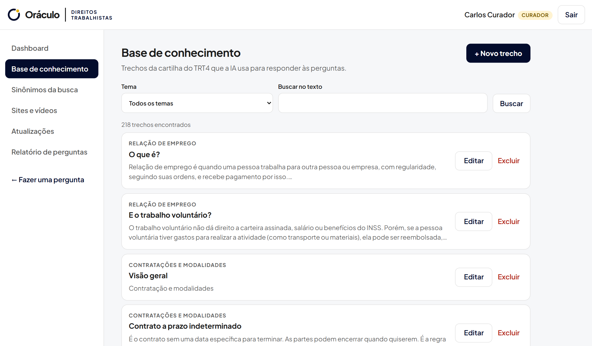
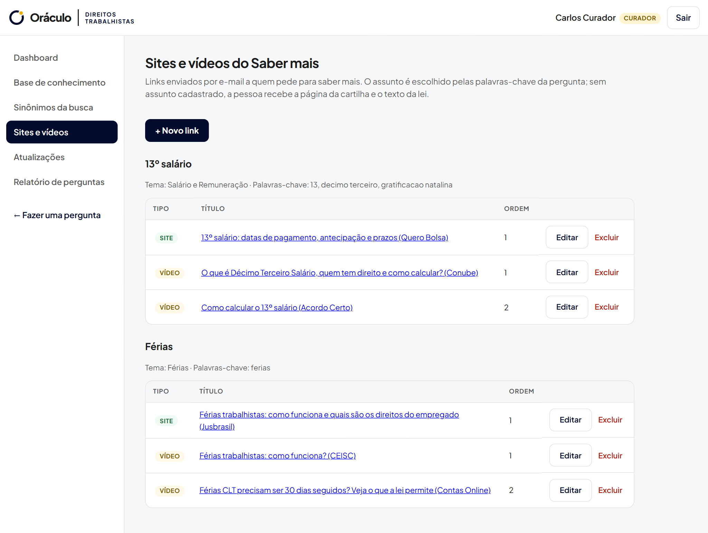
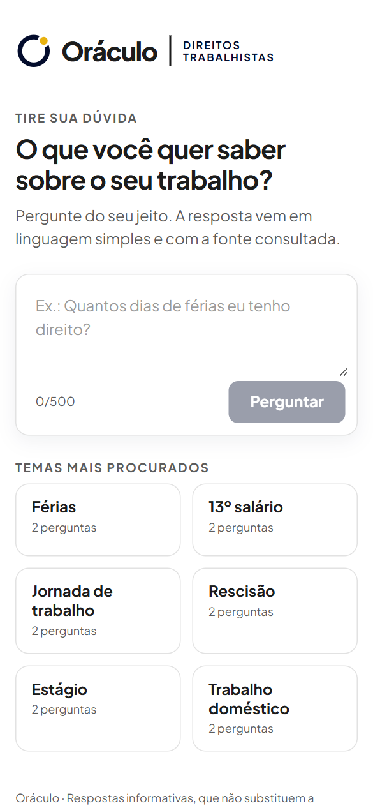

# Sprint 10 — Versão Release Candidate

**Situação:** Concluída: versão 1.0.0-rc.1 publicada e verificada no sistema real · [← Voltar ao índice](../../README.md)

## O que a Sprint pediu

Uma versão candidata à entrega final (Release Candidate): sistema estável, interface final, banco de dados final, APIs documentadas e README atualizado, com evidências, correções, pendências e próximos passos.

## A versão Release Candidate

| | |
| --- | --- |
| **Versão** | 1.0.0-rc.4 (depois da rc.1: fila de modelos reserva da IA e vídeos do YouTube sobre a pergunta no e-mail) |
| **Sistema publicado** | https://oraculo-direitos-trabalhistas-8na.vercel.app (a equipe entra em `/entrar`) |
| **Repositório (README)** | https://github.com/PedroHTLeal/oraculo_direitos_trabalhistas_8na |
| **Documentação da API** | [docs/api.md](../../api.md) e Swagger em https://oraculo-direitos-trabalhistas-8na.vercel.app/api/docs |
| **Banco de dados** | [docs/banco-de-dados.md](../../banco-de-dados.md) |

A versão reúne os três módulos integrados:

1. **Consulta inteligente (sem login):** pergunta em linguagem natural → busca dos trechos da Cartilha do TRT4 (com sinônimos e mais peso para palavras raras) → resposta da IA só com esses trechos, com fontes e link para a cartilha → "Quer saber mais? Sim" envia por e-mail a resposta, sites e vídeos escolhidos pela equipe.
2. **Acompanhamento de temas:** conta com e-mail e senha, temas acompanhados e novidades enviadas por e-mail, em paralelo, a quem acompanha.
3. **Gestão da base de conhecimento (equipe):** trechos da cartilha, sinônimos da busca, sites e vídeos do "Saber mais", atualizações, dashboard, relatórios com exportação em CSV, histórico de operações e gestão de usuários por perfil.

## Entregas

| Item pedido | Como foi atendido | Onde ver |
| --- | --- | --- |
| **Sistema estável** | 106 testes automatizados, que rodam no GitHub a cada envio; roteiro de testes no navegador com o banco real (fluxos principais, validações, permissões, persistência e celular); avaliação da IA com 15 de 15 perguntas aprovadas; problemas das Sprints anteriores corrigidos (tabela abaixo) | [Evidências](#evidências), [Sprint 09](../sprint-09/README.md), [avaliação da IA](../../avaliacao-ia.md) |
| **Interface final** | Revisão das telas: botão "Entrar" fora da consulta, fontes sem repetição, envio do "Saber mais" liberado só com a autorização da LGPD, mensagens de erro claras (inclusive quando a IA está ocupada), menu por perfil e telas adaptadas ao celular; identidade visual também nos e-mails | [Evidências](#evidências), [Sprint 08](../sprint-08/README.md) |
| **Banco de dados final** | 14 tabelas conferidas no banco real; o script `008` removeu a última coluna sem uso e descreveu cada tabela no próprio banco; chaves, regras e segurança documentadas | [banco-de-dados.md](../../banco-de-dados.md), [diagramas](../sprint-02/diagramas.md) |
| **APIs documentadas** | 39 rotas com método, parâmetros, dados de entrada, respostas, acesso e exemplos; Swagger para testar pelo navegador; um teste falha se uma rota nova não for documentada | [api.md](../../api.md), `/api/docs` |
| **README atualizado** | Nome e descrição, objetivo, tecnologias, requisitos, instalação e configuração, banco de dados, como executar, estrutura e integrantes | [README](../../../README.md) |

## Evidências

Prints gerados em 18/11/2026 pelo roteiro automatizado [`capturar_evidencias.py`](../../ferramentas/capturar_evidencias.py), com o sistema rodando e o **banco real** no Supabase: consulta com a IA real, cadastro, login, perfis, CRUD da base, persistência depois de reiniciar o sistema, atualizações, relatórios, sinônimos, sites e vídeos e celular. O roteiro verifica cada passo antes de salvar o print; todos os prints estão em [`docs/evidencias/`](../../evidencias/). Os prints do perfil administrador (usuários, histórico e dashboard do administrador) são de 03/11/2026, porque a conta de demonstração do administrador foi retirada pela equipe; essas telas não mudaram desde então.

**Fluxo principal: pergunta respondida pela IA, com as fontes da cartilha**

**"Saber mais": o envio só é liberado com nome, e-mail e a autorização da LGPD**

**Documentação da API (Swagger)**

**Painel da equipe: dashboard com dados reais**

**Gestão da base de conhecimento**

**Sites e vídeos do Saber mais, mantidos pela equipe**

**Consulta no celular**

## Principais correções e ajustes até a Release Candidate

| Problema | Correção |
| --- | --- |
| A busca não encontrava "estágio" e palavras do dia a dia (B01, B02) | Busca corrigida e tabela de sinônimos |
| Erro 500 intermitente ao abrir a base (B03) | Repetição automática quando a conexão com o banco cai |
| Depois de sair, a próxima pessoa caía na página da anterior (B06) | O endereço de retorno não é guardado ao clicar em Sair |
| Trecho certo fora do alcance da IA em perguntas com palavras raras (B07) | Mais peso para palavras raras na ordenação da busca |
| WhatsApp não entregava as mensagens | Conteúdo complementar e novidades passaram a ser enviados por e-mail ([decisões](../../decisoes.md)) |
| A IA às vezes falhava nos horários de pico do plano gratuito | Fila de 3 modelos reserva (cada um com cota e carga próprias) quando o principal está sobrecarregado, com erro ou sem cota, sempre dentro do limite de 60 s da Vercel |
| Links do "Saber mais" inventados pela pesquisa automática | Links escolhidos e conferidos pela equipe, com tela própria no painel |
| O link de vídeos do e-mail abria a página inicial do YouTube no celular (o aplicativo ignora links de busca) | Para assuntos sem vídeos cadastrados, o e-mail traz os 2 vídeos mais relevantes para a pergunta pela API oficial do YouTube, com link direto para cada vídeo; sem a chave da API, a pesquisa no YouTube filtrada para só vídeos |
| O banco gratuito do Supabase pausa depois de 7 dias sem uso | Banco reativado e conferido nesta Sprint; rotina automática no GitHub Actions o mantém ativo, e a reativação está documentada |

O registro completo, com data e objetivo de cada ajuste, está no [CHANGELOG](../../../CHANGELOG.md).

## Ajustes desta Sprint

| Commit | O que mudou |
| --- | --- |
| [`f4b5a7d`](https://github.com/PedroHTLeal/oraculo_direitos_trabalhistas_8na/commit/f4b5a7d) | API documentada (Swagger e docs/api.md), banco final descrito, script 008 e README completo |
| [`4e9ca91`](https://github.com/PedroHTLeal/oraculo_direitos_trabalhistas_8na/commit/4e9ca91) | IA troca para o modelo reserva em qualquer falha do Google, sem esperas longas |
| Versão `v1.0.0-rc.1` | Mensagem clara quando a IA está ocupada, roteiro de evidências com o fluxo principal e a API, página da Sprint 10 e relatório com as Sprints 01 a 10 |

## Pendências e próximos passos

| Pendência | Como será resolvida |
| --- | --- |
| Chave da API do YouTube, para o e-mail trazer os 2 vídeos mais relevantes para cada pergunta (hoje, sem a chave, vai o link da pesquisa no YouTube só com vídeos) | **Responsável: Gerson Martinho Mesquita Neto.** Criar a chave gratuita no Google Cloud e colocá-la no `backend/.env` e na Vercel (`YOUTUBE_API_KEY`), conforme o [guia de configuração](../../configuracao.md), seção 4; depois testar o "Saber mais" com uma pergunta sem vídeos cadastrados |
| Conversa com o outro orientador sobre paralelismo | A equipe vai apresentar o [material de paralelismo](../../paralelismo.md) e registrar as observações antes da entrega final |
| Sites e vídeos para as demais perguntas sugeridas | A equipe vai cadastrar os links pela tela **Sites e vídeos** do painel |
| Revisão de usabilidade com pessoas do público-alvo | Teste com trabalhadores e estudantes antes da apresentação final, com as melhorias registradas na Sprint 08 |
| Limites do plano gratuito (cota diária da IA e pausa do banco) | A pausa do banco é evitada pela rotina automática [`manter-ativo.yml`](../../../.github/workflows/manter-ativo.yml), que usa o banco a cada 2 dias; no dia da apresentação, evitar testes desnecessários para não gastar a cota diária da IA |
| Conta de teste "João Teste" criada pelo roteiro de evidências | Excluir em **Usuários** (perfil administrador); o roteiro só a apaga quando há uma conta de demonstração de administrador |
